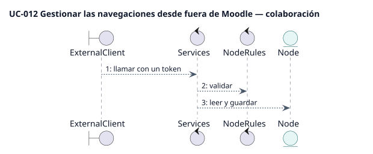

# UC-012 Gestionar las navegaciones desde fuera de Moodle — realización de análisis

| Vista general | Requisitos | Análisis | Diseño | Implementación | Pruebas |
| --- | --- | --- | --- | --- | --- |
| [Casos de uso](../../../requirements/use-case-overview.svg) | [Requisitos](../../../requirements/use-cases/manageByWebService/README.md) | **Análisis** | [Diseño](../../../design/use-cases/manageByWebService/README.md) | [Implementación](../../../implementation/use-cases/manageByWebService/README.md) | [Pruebas](../../../implementation/use-cases/manageByWebService/README.md#tests) |

Requisitos: [README](../../../requirements/use-cases/manageByWebService/README.md)

## Clases participantes

| Clase | Estereotipo | Responsabilidad |
| --- | --- | --- |
| ExternalClient | boundary | El sistema fuera de Moodle. |
| Services | control | Las funciones: enumerar, guardar, cambiar, exportar, importar y buscar. |
| NodeRules | control | Las comprobaciones de un nodo y de un archivo de importación. |
| Node | entity | Una fila de la navegación. |

## Colaboración

## Notas

La búsqueda de lo que un archivo puede contener (navegaciones, tipos de actividad, usuarios, cursos, categorías) también es un servicio, que devuelve diez resultados cada vez.
