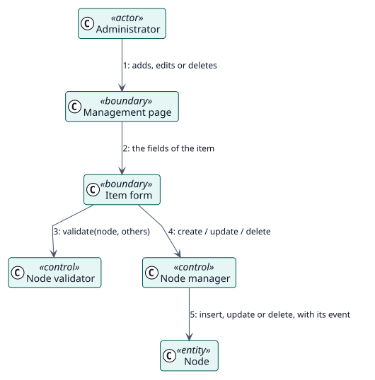

# UC-001 Añadir, cambiar o eliminar un elemento — realización del análisis

| Resumen | Requisitos | Análisis | Diseño | Implementación | Pruebas |
| --- | --- | --- | --- | --- | --- |
| [Casos de uso](../../../requirements/use-case-overview.svg) | [Requisitos](../../../requirements/use-cases/manageNodes/README.md) | **Análisis** | [Diseño](../../../design/use-cases/manageNodes/README.md) | [Implementación](../../../implementation/use-cases/manageNodes/README.md) | [Pruebas](../../../implementation/use-cases/manageNodes/README.md#pruebas) |

Requisitos: [README](../../../requirements/use-cases/manageNodes/README.md)

## Clases participantes

| Clase | Estereotipo | Responsabilidad |
| --- | --- | --- |
| Página de gestión | frontera | Lista los elementos y sus acciones. |
| Formulario del elemento | frontera | Recoge los campos de un elemento. |
| Validador de nodos | control | Rechaza los elementos no válidos. |
| Gestor de nodos | control | Crea, cambia y elimina nodos. |
| Nodo | entidad | El elemento almacenado. |

## Colaboración

## Notas

El mismo gestor lo usan el formulario, la importación y la sincronización con los elementos de menú personalizados de Moodle.
