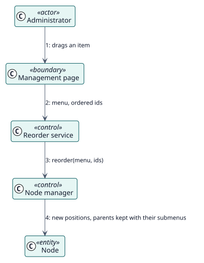

# UC-002 Reordenar los elementos — realización del análisis

| Resumen | Requisitos | Análisis | Diseño | Implementación | Pruebas |
| --- | --- | --- | --- | --- | --- |
| [Casos de uso](../../../requirements/use-case-overview.svg) | [Requisitos](../../../requirements/use-cases/reorderNodes/README.md) | **Análisis** | [Diseño](../../../design/use-cases/reorderNodes/README.md) | [Implementación](../../../implementation/use-cases/reorderNodes/README.md) | [Pruebas](../../../implementation/use-cases/reorderNodes/README.md#pruebas) |

Requisitos: [README](../../../requirements/use-cases/reorderNodes/README.md)

## Clases participantes

| Clase | Estereotipo | Responsabilidad |
| --- | --- | --- |
| Página de gestión | frontera | Muestra las asas y la lista de posiciones. |
| Servicio de orden | control | Recibe los ids en su nuevo orden. |
| Gestor de nodos | control | Escribe las posiciones. |
| Nodo | entidad | El elemento que se mueve. |

## Colaboración

## Notas

La posición de cada elemento se exporta en el campo `order`, de modo que una importación la conserva.
