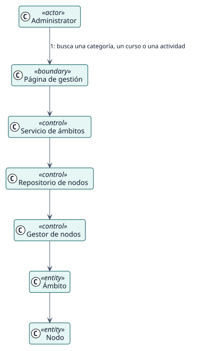

# UC-007 Cambiar una navegación para una categoría o un curso — realización del análisis

| Resumen | Requisitos | Análisis | Diseño | Implementación | Pruebas |
| --- | --- | --- | --- | --- | --- |
| [Casos de uso](../../../requirements/use-case-overview.svg) | [Requisitos](../../../requirements/use-cases/setScopeException/README.md) | **Análisis** | [Diseño](../../../design/use-cases/setScopeException/README.md) | [Implementación](../../../implementation/use-cases/setScopeException/README.md) | [Pruebas](../../../implementation/use-cases/setScopeException/README.md#tests) |

Requisitos: [README](../../../requirements/use-cases/setScopeException/README.md)

## Clases participantes

| Clase | Estereotipo | Responsabilidad |
| --- | --- | --- |
| Página de gestión | boundary | Elige el ámbito y muestra lo que ve. |
| Servicio de ámbitos | control | Encuentra las categorías y cursos con cambios y los que halla una búsqueda. |
| Repositorio de nodos | control | Devuelve los nodos que se aplican a un contexto, ganando el ámbito más cercano. |
| Gestor de nodos | control | Hace las excepciones y las cambia. |
| Ámbito | entity | Una categoría o un curso que cambia una navegación. |
| Nodo | entity | Un nodo de una navegación y sus reglas. |

## Colaboración

