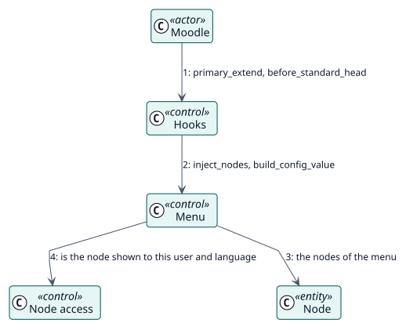

# UC-004 Mostrar los menús de un usuario — realización del análisis

| Resumen | Requisitos | Análisis | Diseño | Implementación | Pruebas |
| --- | --- | --- | --- | --- | --- |
| [Casos de uso](../../../requirements/use-case-overview.svg) | [Requisitos](../../../requirements/use-cases/showMenus/README.md) | **Análisis** | [Diseño](../../../design/use-cases/showMenus/README.md) | [Implementación](../../../implementation/use-cases/showMenus/README.md) | [Pruebas](../../../implementation/use-cases/showMenus/README.md#pruebas) |

Requisitos: [README](../../../requirements/use-cases/showMenus/README.md)

## Clases participantes

| Clase | Estereotipo | Responsabilidad |
| --- | --- | --- |
| Ganchos | control | Reaccionan a los ganchos de Moodle. |
| Menú | control | Coloca los nodos donde Moodle los espera. |
| Acceso a nodos | control | Indica si un nodo se muestra a un usuario y a un idioma. |
| Nodo | entidad | El elemento. |

## Colaboración

## Notas

El menú de usuario se reescribe para cada usuario en cada petición; los ajustes reales se conservan y se restauran en las páginas de administración.
