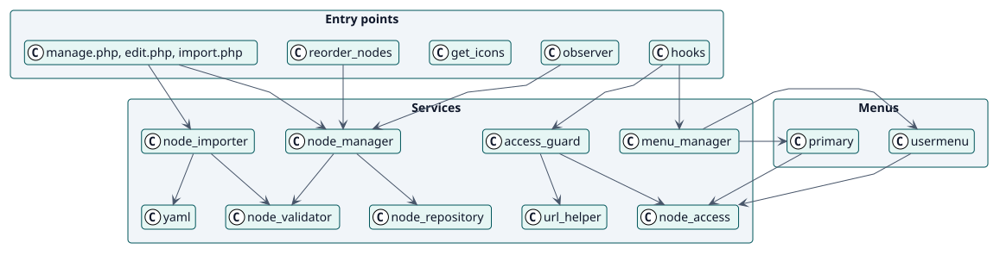
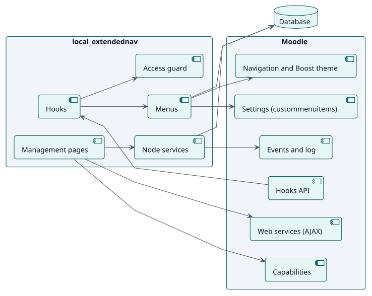
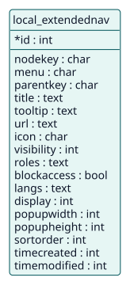

# Diseño

## Arquitectura

Extended navigation es un plugin local de Moodle con tres capas:

- **Puntos de entrada**: las páginas de gestión (`manage.php`, `edit.php`, `import.php`, `export.php`, `activity.php`), dos funciones de servicio web para ordenar y para los iconos, los ganchos de Moodle y un observador.
- **Servicios**: clases en `classes/local/` y los menús de `classes/menu/`. `node_manager` y `node_importer` cambian nodos, `node_validator` rechaza los no válidos, `node_access` y `access_guard` deciden quién ve y quién abre.
- **Persistencia**: una tabla, `local_extendednav`.

Dos decisiones dan forma al diseño. Primero, **los menús se construyen en cada petición mediante la API de ganchos**, de modo que un cambio se ve al instante y no se reescribe nada de Moodle en sus tablas. Segundo, **la guardia lee los mismos nodos y las mismas reglas que los menús**, de modo que una página se bloquea exactamente para los usuarios que no ven su elemento.

## Clases de diseño

## Componentes

## Modelo de datos

## Realizaciones de casos de uso

| ID | Caso de uso | Secuencia |
| --- | --- | --- |
| UC-001 | [Añadir, cambiar o eliminar un elemento](./use-cases/manageNodes/README.md) | [secuencia](./use-cases/manageNodes/sequence.svg) |
| UC-002 | [Reordenar los elementos](./use-cases/reorderNodes/README.md) | [secuencia](./use-cases/reorderNodes/sequence.svg) |
| UC-003 | [Importar y exportar elementos](./use-cases/importNodes/README.md) | [secuencia](./use-cases/importNodes/sequence.svg) |
| UC-004 | [Mostrar los menús de un usuario](./use-cases/showMenus/README.md) | [secuencia](./use-cases/showMenus/sequence.svg) |
| UC-005 | [Bloquear las páginas de los elementos ocultos](./use-cases/blockUrl/README.md) | [secuencia](./use-cases/blockUrl/sequence.svg) |
