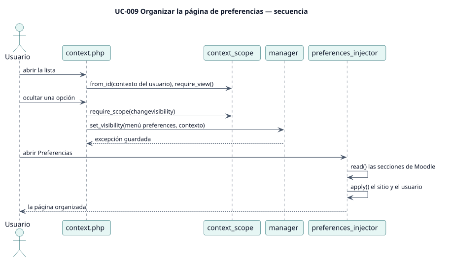

# UC-009 Organizar la página de preferencias — realización de diseño

| Vista general | Requisitos | Análisis | Diseño | Implementación | Pruebas |
| --- | --- | --- | --- | --- | --- |
| [Casos de uso](../../../requirements/use-case-overview.svg) | [Requisitos](../../../requirements/use-cases/arrangePreferences/README.md) | [Análisis](../../../analysis/use-cases/arrangePreferences/README.md) | **Diseño** | [Implementación](../../../implementation/use-cases/arrangePreferences/README.md) | [Pruebas](../../../implementation/use-cases/arrangePreferences/README.md#tests) |

## Clases

| Clase de análisis | Clase de diseño | Notas |
| --- | --- | --- |
| PreferencesPage | `local_extendednav_extend_navigation_user_settings` (`lib.php`) | Llama al inyector cuando Moodle construye los ajustes de un usuario. |
| NavigationPage | `context.php`, `templates/manage/page.mustache`, `amd/src/manage.js` | La misma lista que las demás navegaciones, en carpetas. |
| PreferencesInjector | `local_extendednav\local\navigation\preferences_injector` | `read()`, `record()`, `apply()`, `order()`. |
| ContextScope | `local_extendednav\local\navigation\context_scope` | `is_user()`, `can()`, `PERSONAL`. |
| Node | tabla `local_extendednav` | Filas del sitio y del contexto del usuario, del menú `preferences`. |

## Decisiones

- La organización de un usuario se guarda como excepciones de su contexto, igual que los cambios de un curso, por lo que la lista, el orden, los servicios, la exportación y la privacidad del plugin funcionan sobre ella sin código propio.
- Moodle construye secciones sin clave (Roles) y opciones numeradas: una sección sin clave se conoce por su primera opción, y una opción por la ruta de su URL.
- Un usuario puede cambiar la visibilidad y el orden de su página y renombrar sus opciones; adónde lleva una opción lo decide Moodle.

## Secuencia

