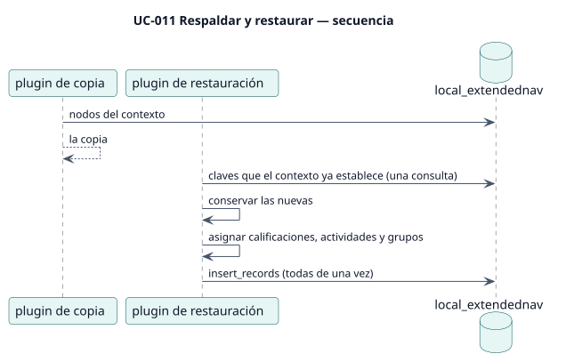

# UC-011 Respaldar y restaurar los cambios de un curso — realización de diseño

| Vista general | Requisitos | Análisis | Diseño | Implementación | Pruebas |
| --- | --- | --- | --- | --- | --- |
| [Casos de uso](../../../requirements/use-case-overview.svg) | [Requisitos](../../../requirements/use-cases/backUpChanges/README.md) | [Análisis](../../../analysis/use-cases/backUpChanges/README.md) | **Diseño** | [Implementación](../../../implementation/use-cases/backUpChanges/README.md) | [Pruebas](../../../implementation/use-cases/backUpChanges/README.md#tests) |

## Clases

| Clase de análisis | Clase de diseño | Notas |
| --- | --- | --- |
| BackupDefaults | `settings.php` | `backup_navigation` y `restore_navigation`, añadidos a las páginas de Moodle. |
| BackupPlugin | `backup_local_extendednav_plugin` | Tabla de origen `local_extendednav` por contexto. |
| RestorePlugin | `restore_local_extendednav_plugin` | `process_navigation_node()`, `map_activity_conditions()`. |
| Node | tabla `local_extendednav` | Filas con `contextid` del curso o de la actividad. |

## Decisiones

- Las filas a guardar se reúnen mientras se lee la copia y se insertan de una vez cuando todo el curso está restaurado, para que las condiciones puedan apuntar a las actividades y calificaciones restauradas.
- Las claves que el contexto ya establece se leen en una consulta por contexto, no una consulta por nodo.

## Secuencia

