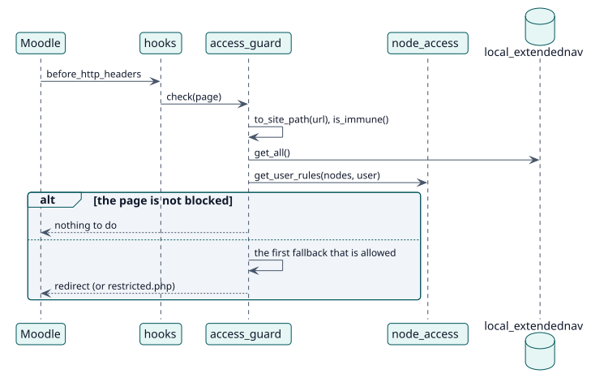

# UC-005 Bloquear las páginas de los elementos ocultos — realización del diseño

| Resumen | Requisitos | Análisis | Diseño | Implementación | Pruebas |
| --- | --- | --- | --- | --- | --- |
| [Casos de uso](../../../requirements/use-case-overview.svg) | [Requisitos](../../../requirements/use-cases/blockUrl/README.md) | [Análisis](../../../analysis/use-cases/blockUrl/README.md) | **Diseño** | [Implementación](../../../implementation/use-cases/blockUrl/README.md) | [Pruebas](../../../implementation/use-cases/blockUrl/README.md#pruebas) |

Análisis: [README](../../../analysis/use-cases/blockUrl/README.md)

## Elementos

| Elemento de diseño | Tipo | Código |
| --- | --- | --- |
| `hooks::before_http_headers` | gancho | `classes/hooks.php:61` |
| `access_guard::check` | servicio | `classes/local/access_guard.php:51` |
| `access_guard::evaluate` | servicio | `classes/local/access_guard.php:79` |

## Secuencia

## Contratos

| Operación | Entrada | Salida | Errores |
| --- | --- | --- | --- |
| `access_guard::evaluate(current, userid)` | la ruta del sitio y el usuario | null si está permitida, la ruta a la que ir, o una cadena vacía | ninguno |

## Datos que toca

| Tabla o entidad | Operación |
| --- | --- |
| `local_extendednav` | lectura |
