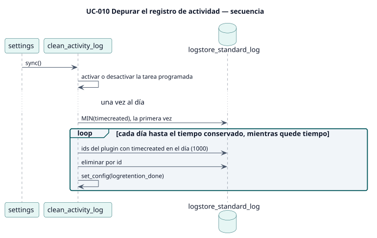

# UC-010 Depurar el registro de actividad — realización de diseño

| Vista general | Requisitos | Análisis | Diseño | Implementación | Pruebas |
| --- | --- | --- | --- | --- | --- |
| [Casos de uso](../../../requirements/use-case-overview.svg) | [Requisitos](../../../requirements/use-cases/cleanActivityLog/README.md) | [Análisis](../../../analysis/use-cases/cleanActivityLog/README.md) | **Diseño** | [Implementación](../../../implementation/use-cases/cleanActivityLog/README.md) | [Pruebas](../../../implementation/use-cases/cleanActivityLog/README.md#tests) |

## Clases

| Clase de análisis | Clase de diseño | Notas |
| --- | --- | --- |
| LogSettings | `settings.php` | Una casilla y una duración sin límite superior; ambas llaman a `clean_activity_log::sync` al guardarse. |
| CleanTask | `local_extendednav\task\clean_activity_log` | `sync()`, `clean()`, `is_wanted()`; horario en `db/tasks.php`, desactivada hasta que el ajuste la activa. |
| StandardLog | tabla `logstore_standard_log` | Se lee por `timecreated` y `component`. |

## Decisiones

- La tabla tiene un índice por el tiempo y ninguno por el componente, así que la tarea lee un día de tiempo cada vez y filtra el componente dentro de él.
- Los identificadores se leen por lotes y se eliminan por su clave primaria, así que ninguna consulta toca la tabla entera ni mantiene un bloqueo durante mucho tiempo.
- La tarea está desactivada, no solo inactiva, mientras la depuración está desactivada, así que no aparece entre las tareas que se ejecutan.

## Secuencia

