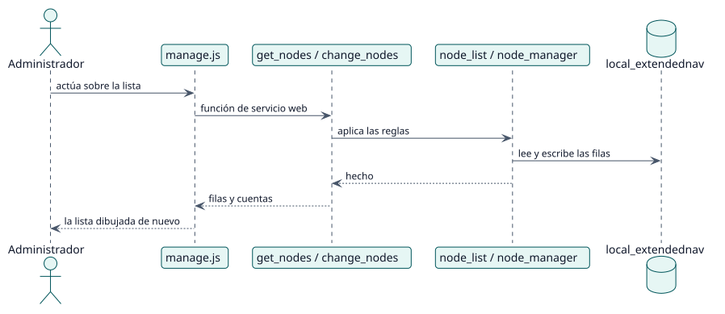

# UC-006 Personalizar una navegación secundaria — diseño

| Resumen | Requisitos | Análisis | Diseño | Implementación | Pruebas |
| --- | --- | --- | --- | --- | --- |
| [Casos de uso](../../../requirements/use-case-overview.svg) | [Requisitos](../../../requirements/use-cases/customiseSecondaryNavigation/README.md) | [Análisis](../../../analysis/use-cases/customiseSecondaryNavigation/README.md) | **Diseño** | [Implementación](../../../implementation/use-cases/customiseSecondaryNavigation/README.md) | [Pruebas](../../../implementation/use-cases/customiseSecondaryNavigation/README.md#tests) |

Análisis: [README](../../../analysis/use-cases/customiseSecondaryNavigation/README.md)

## Elementos

| Elemento de diseño | Tipo | Destino en el código |
| --- | --- | --- |
| `get_nodes::execute` | service | `classes/external/get_nodes.php` |
| `change_nodes::set_visibility`, `delete`, `move` | service | `classes/external/change_nodes.php` |
| `node_list::get` | service | `classes/local/node_list.php` |
| `node_manager::set_visibility`, `move` | service | `classes/local/node_manager.php` |
| `secondary::record_seen` | service | `classes/menu/secondary.php` |
| `secondary_navigation::apply` | service | `classes/local/secondary_navigation.php` |

## Secuencia

## Contratos

| Operación | Entrada | Salida | Errores |
| --- | --- | --- | --- |
| `local_extendednav_get_nodes(menu, contextid, search, visibility, parent, page, perpage)` | la navegación, el ámbito y los filtros | filas, total, cuentas y si la lista se puede reordenar | sin capacidad, navegación desconocida, visibilidad no admitida |
| `local_extendednav_set_visibility(menu, contextid, nodekeys, visibility)` | los nodos y la nueva visibilidad | cuántos cambiaron | sin capacidad, visibilidad distinta de oculto o visible |
| `local_extendednav_move_node(menu, contextid, nodekey, direction)` | el nodo y la dirección | cuántos se movieron | sin capacidad, dirección distinta de -1 o 1 |

## Datos afectados

| Tabla o entidad | Operación |
| --- | --- |
| `local_extendednav` | select, insert (un nodo visto por primera vez), update (visibilidad, posición) |
| `config_plugins` (`nativenodes_<navegación>`) | update, una vez por cada nodo visto |
