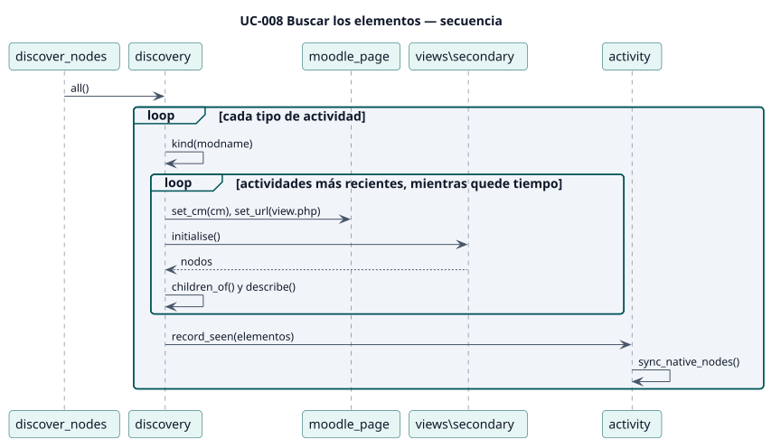

# UC-008 Buscar los elementos de la navegación de cada tipo de actividad — realización de diseño

| Vista general | Requisitos | Análisis | Diseño | Implementación | Pruebas |
| --- | --- | --- | --- | --- | --- |
| [Casos de uso](../../../requirements/use-case-overview.svg) | [Requisitos](../../../requirements/use-cases/discoverActivityItems/README.md) | [Análisis](../../../analysis/use-cases/discoverActivityItems/README.md) | **Diseño** | [Implementación](../../../implementation/use-cases/discoverActivityItems/README.md) | [Pruebas](../../../implementation/use-cases/discoverActivityItems/README.md#tests) |

## Clases

| Clase de análisis | Clase de diseño | Notas |
| --- | --- | --- |
| DiscoverTask | `local_extendednav\task\discover_nodes` | Tarea programada, una vez al día a las 03:00 (minuto aleatorio). |
| FindItemsButton | `local_extendednav_discover_nodes` (servicio web), `amd/src/manage.js` | 30 actividades, 8 segundos como máximo. |
| Discovery | `local_extendednav\local\navigation\discovery` | `kind()`, `all()`, `nodes_of()`. |
| ActivityNavigation | `local_extendednav\menu\activity` | Clave `mod_<módulo>`; elementos en el ajuste `nativenodes_mod_<módulo>`. |
| Node | tabla `local_extendednav` | Una fila creada por `base::sync_native_nodes`. |

## Decisiones

- Moodle y sus plugins leen la página en construcción desde la variable global `$PAGE`, de modo que la página de la actividad ocupa su lugar mientras se construye la navegación y lo devuelve después, también cuando la construcción falla.
- La clave de un elemento que Moodle numera es la ruta de su URL (`secondary::key_of`), la misma que usan las páginas, de modo que el elemento encontrado y el elemento mostrado son uno.
- Primero se revisan las actividades más recientes: un plugin que añade un elemento a algunas actividades suele configurarse en las nuevas.

## Secuencia

