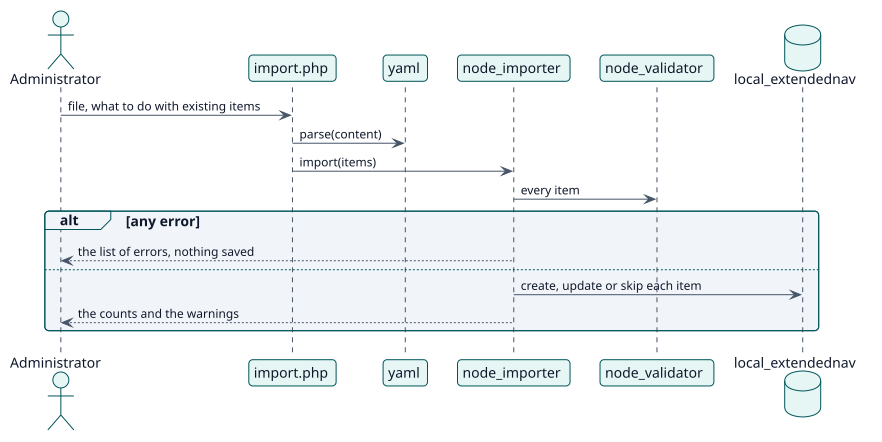

# UC-003 Importar y exportar elementos — realización del diseño

| Resumen | Requisitos | Análisis | Diseño | Implementación | Pruebas |
| --- | --- | --- | --- | --- | --- |
| [Casos de uso](../../../requirements/use-case-overview.svg) | [Requisitos](../../../requirements/use-cases/importNodes/README.md) | [Análisis](../../../analysis/use-cases/importNodes/README.md) | **Diseño** | [Implementación](../../../implementation/use-cases/importNodes/README.md) | [Pruebas](../../../implementation/use-cases/importNodes/README.md#pruebas) |

Análisis: [README](../../../analysis/use-cases/importNodes/README.md)

## Elementos

| Elemento de diseño | Tipo | Código |
| --- | --- | --- |
| `node_importer::import` | servicio | `classes/local/node_importer.php:110` |
| `node_importer::export_nodes` | servicio | `classes/local/node_importer.php:66` |
| `yaml::parse` | servicio | `classes/yaml.php:61` |

## Secuencia

## Contratos

| Operación | Entrada | Salida | Errores |
| --- | --- | --- | --- |
| `node_importer::import(items)` | los elementos leídos del archivo | los errores, las advertencias y los recuentos | elementos no válidos |

## Datos que toca

| Tabla o entidad | Operación |
| --- | --- |
| `local_extendednav` | inserción, actualización |
| `logstore_standard_log` | inserción |
