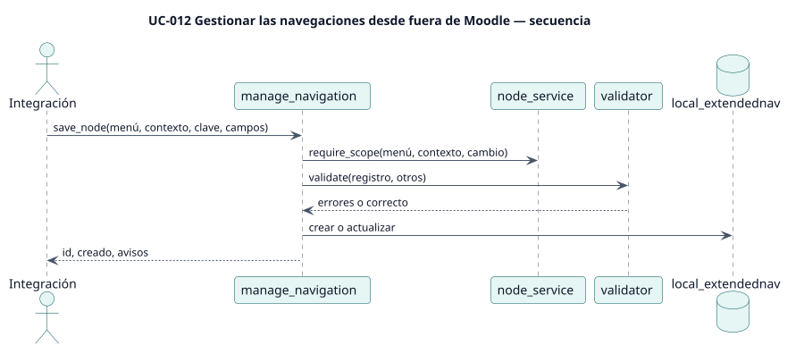

# UC-012 Gestionar las navegaciones desde fuera de Moodle — realización de diseño

| Vista general | Requisitos | Análisis | Diseño | Implementación | Pruebas |
| --- | --- | --- | --- | --- | --- |
| [Casos de uso](../../../requirements/use-case-overview.svg) | [Requisitos](../../../requirements/use-cases/manageByWebService/README.md) | [Análisis](../../../analysis/use-cases/manageByWebService/README.md) | **Diseño** | [Implementación](../../../implementation/use-cases/manageByWebService/README.md) | [Pruebas](../../../implementation/use-cases/manageByWebService/README.md#tests) |

## Clases

| Clase de análisis | Clase de diseño | Notas |
| --- | --- | --- |
| ExternalClient | El servicio `local_extendednav` (usuarios restringidos) | Definido en `db/services.php` con todas las funciones del plugin. |
| Services | `local_extendednav\external\manage_navigation`, `change_nodes`, `get_nodes`, `reorder_nodes`, `search_export` | Cada función comprueba su ámbito con `node_service::require_scope`. |
| NodeRules | `local_extendednav\local\node\validator`, `local_extendednav\local\io\importer` | Las mismas que usan el formulario y la página de importación. |
| Node | tabla `local_extendednav` |  |

## Decisiones

- Los servicios comprueban el ámbito de un contexto con la misma clase que usan las páginas, así que un usuario, un curso y una categoría conservan sus capacidades.
- Un campo que las capacidades del contexto bloquean no se puede enviar: el servicio lo rechaza en lugar de ignorarlo.

## Secuencia

