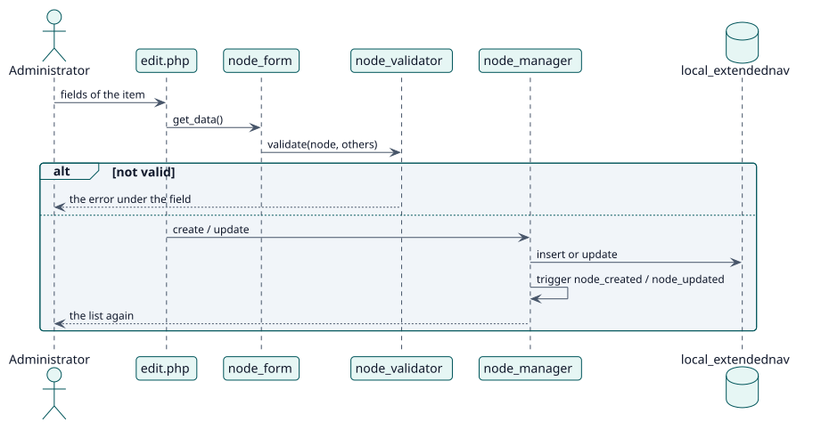

# UC-001 Añadir, cambiar o eliminar un elemento — realización del diseño

| Resumen | Requisitos | Análisis | Diseño | Implementación | Pruebas |
| --- | --- | --- | --- | --- | --- |
| [Casos de uso](../../../requirements/use-case-overview.svg) | [Requisitos](../../../requirements/use-cases/manageNodes/README.md) | [Análisis](../../../analysis/use-cases/manageNodes/README.md) | **Diseño** | [Implementación](../../../implementation/use-cases/manageNodes/README.md) | [Pruebas](../../../implementation/use-cases/manageNodes/README.md#pruebas) |

Análisis: [README](../../../analysis/use-cases/manageNodes/README.md)

## Elementos

| Elemento de diseño | Tipo | Código |
| --- | --- | --- |
| `node_validator::validate` | servicio | `classes/local/node_validator.php:46` |
| `node_manager::create` | servicio | `classes/local/node_manager.php:104` |
| `node_manager::update` | servicio | `classes/local/node_manager.php:134` |
| `node_manager::delete` | servicio | `classes/local/node_manager.php:159` |

## Secuencia

## Contratos

| Operación | Entrada | Salida | Errores |
| --- | --- | --- | --- |
| `node_manager::create(record, events)` | el elemento | el registro guardado con su id | elemento no válido |

## Datos que toca

| Tabla o entidad | Operación |
| --- | --- |
| `local_extendednav` | inserción, actualización, borrado |
| `logstore_standard_log` | inserción (un evento por cambio) |
