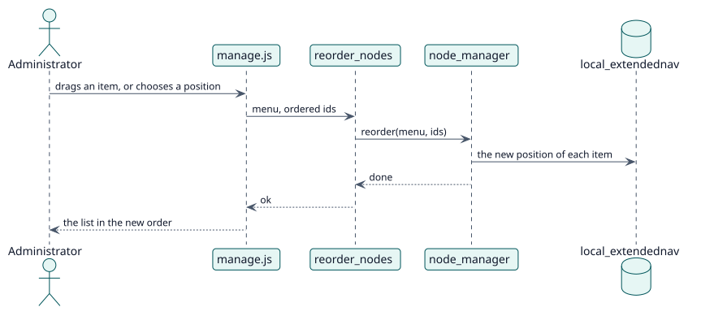

# UC-002 Reordenar los elementos — realización del diseño

| Resumen | Requisitos | Análisis | Diseño | Implementación | Pruebas |
| --- | --- | --- | --- | --- | --- |
| [Casos de uso](../../../requirements/use-case-overview.svg) | [Requisitos](../../../requirements/use-cases/reorderNodes/README.md) | [Análisis](../../../analysis/use-cases/reorderNodes/README.md) | **Diseño** | [Implementación](../../../implementation/use-cases/reorderNodes/README.md) | [Pruebas](../../../implementation/use-cases/reorderNodes/README.md#pruebas) |

Análisis: [README](../../../analysis/use-cases/reorderNodes/README.md)

## Elementos

| Elemento de diseño | Tipo | Código |
| --- | --- | --- |
| `reorder_nodes::execute` | servicio | `classes/external/reorder_nodes.php:58` |
| `node_manager::reorder` | servicio | `classes/local/node_manager.php:248` |

## Secuencia

## Contratos

| Operación | Entrada | Salida | Errores |
| --- | --- | --- | --- |
| `local_extendednav_reorder_nodes(menu, ids)` | el menú y los ids en el nuevo orden | el resultado del cambio | sin capacidad, menú no válido |

## Datos que toca

| Tabla o entidad | Operación |
| --- | --- |
| `local_extendednav` | actualización (posición) |
