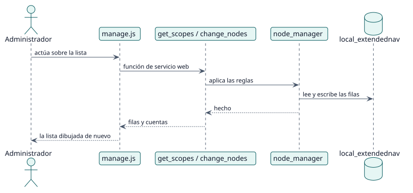

# UC-007 Cambiar una navegación para una categoría o un curso — diseño

| Resumen | Requisitos | Análisis | Diseño | Implementación | Pruebas |
| --- | --- | --- | --- | --- | --- |
| [Casos de uso](../../../requirements/use-case-overview.svg) | [Requisitos](../../../requirements/use-cases/setScopeException/README.md) | [Análisis](../../../analysis/use-cases/setScopeException/README.md) | **Diseño** | [Implementación](../../../implementation/use-cases/setScopeException/README.md) | [Pruebas](../../../implementation/use-cases/setScopeException/README.md#tests) |

Análisis: [README](../../../analysis/use-cases/setScopeException/README.md)

## Elementos

| Elemento de diseño | Tipo | Destino en el código |
| --- | --- | --- |
| `get_scopes::execute` | service | `classes/external/get_scopes.php` |
| `repository::get_scoped_nodes` | service | `classes/local/node/repository.php` |
| `manager::ensure_row`, `set_visibility`, `save_order` | service | `classes/local/node/manager.php` |

## Secuencia

## Contratos

| Operación | Entrada | Salida | Errores |
| --- | --- | --- | --- |
| `local_extendednav_get_scopes(menu, search)` | la navegación y una parte de un nombre | los ámbitos: contexto, nombre, tipo y cambios | sin capacidad, navegación desconocida |
| `local_extendednav_delete_nodes(menu, contextid, nodekeys)` | el ámbito y los nodos | cuántas excepciones se quitaron | sin capacidad, un ámbito que no es una categoría ni un curso |

## Datos afectados

| Tabla o entidad | Operación |
| --- | --- |
| `local_extendednav` | insert (una fila del ámbito), update, delete (volver al sitio) |
| `course`, `course_categories` | select, para encontrar el ámbito |
