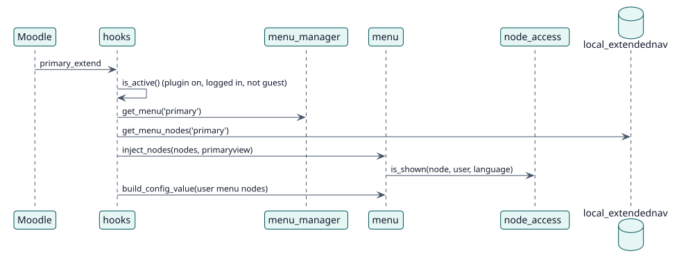

# UC-004 Mostrar los menús de un usuario — realización del diseño

| Resumen | Requisitos | Análisis | Diseño | Implementación | Pruebas |
| --- | --- | --- | --- | --- | --- |
| [Casos de uso](../../../requirements/use-case-overview.svg) | [Requisitos](../../../requirements/use-cases/showMenus/README.md) | [Análisis](../../../analysis/use-cases/showMenus/README.md) | **Diseño** | [Implementación](../../../implementation/use-cases/showMenus/README.md) | [Pruebas](../../../implementation/use-cases/showMenus/README.md#pruebas) |

Análisis: [README](../../../analysis/use-cases/showMenus/README.md)

## Elementos

| Elemento de diseño | Tipo | Código |
| --- | --- | --- |
| `hooks::extend_primary_navigation` | gancho | `classes/hooks.php:74` |
| `hooks::before_top_of_body` | gancho | `classes/hooks.php:108` |
| `node_access::is_shown` | servicio | `classes/local/node_access.php:166` |

## Secuencia

## Contratos

| Operación | Entrada | Salida | Errores |
| --- | --- | --- | --- |
| `inject_nodes(nodes, primaryview)` | los nodos del menú y la vista de la navegación | la navegación con los nodos añadidos | ninguno |

## Datos que toca

| Tabla o entidad | Operación |
| --- | --- |
| `local_extendednav` | lectura |
| `config` | lectura (elementos de menú personalizados) |
