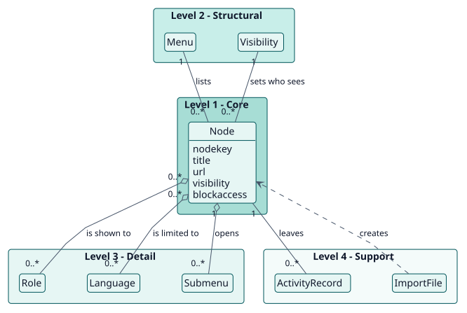
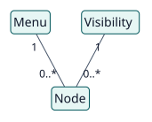
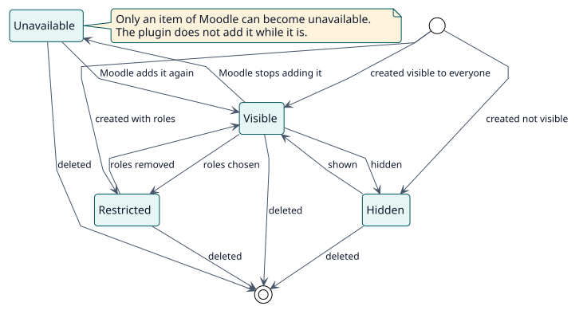

# Modelo de dominio

## Propósito

Los menús de Moodle son iguales para todos y solo se pueden configurar en parte. Extended navigation permite que un administrador dé forma a los dos menús que ve todo usuario y decida, elemento por elemento, quién lo ve y quién puede abrir su página. Este modelo nombra los conceptos que hay detrás.

## Jerarquía de entidades

La posición vertical de una entidad expresa su importancia para el objetivo del proyecto. No es herencia ni composición UML.

| Nivel | Significado | Entidades | Por qué están aquí |
| --- | --- | --- | --- |
| 1 | Núcleo: el proyecto no puede existir sin ellas | Node | El plugin existe para describir un elemento de un menú y sus reglas. |
| 2 | Estructurales: dependen directamente del núcleo | Menu, Visibility | Un nodo pertenece a un menú y tiene una visibilidad. |
| 3 | Detalle: cualifican o especializan el nivel 2 | Role, Language, Submenu | Limitan quién ve un nodo y cómo se anidan los nodos. |
| 4 | Soporte: catálogos, auditoría, configuración | ActivityRecord, ImportFile | Registran lo que cambió y llevan navegaciones entre sitios. |

## Diagramas

## Diccionario de entidades

| Entidad | Nivel | Definición | Atributos clave | Atributos omitidos y motivo |
| --- | --- | --- | --- | --- |
| Node | 1 | Un elemento de la navegación principal o del menú de usuario, añadido por el plugin o un elemento de Moodle que el plugin cambia. | `nodekey`, `menu`, `title`, `url`, `visibility`, `blockaccess` | El resto están en el [modelo de datos](../design/data-model/data-model.svg). |
| Menu | 2 | Uno de los dos menús: la navegación principal o el menú de usuario. | `primary`, `usermenu` | Es una clase del plugin, no una tabla. |
| Visibility | 2 | Quién ve un nodo: todos, los usuarios con algunos roles o nadie. | `visibility` | |
| Role | 3 | Un rol que puede ver un nodo restringido. | nombre corto del rol | Es el `role` de Moodle. |
| Language | 3 | Un idioma al que se limita un nodo. | código de idioma | Es una lista de códigos en el nodo. |
| Submenu | 3 | Los nodos que se muestran bajo un nodo padre, a un nivel de profundidad. | `parentkey` | |
| ActivityRecord | 4 | Un evento del registro de Moodle escrito cuando un nodo se crea, cambia o elimina. | evento, usuario, hora | Es el registro de Moodle. |
| ImportFile | 4 | Un archivo YAML que lleva nodos entre sitios. | la lista `nodes` | No se almacena. |

## Reglas de negocio

| ID | Regla | Entidades | Fuente |
| --- | --- | --- | --- |
| RN-001 | Un nodo se muestra a un usuario cuando su visibilidad se lo permite y sus idiomas incluyen el idioma actual del usuario; un padre oculto oculta su submenú. | Node, Role, Language | `node_access::is_shown` |
| RN-002 | Una clave de nodo es única dentro de su menú, y solo se permiten letras, números, guiones bajos y guiones. | Node | `node_validator::validate` |
| RN-003 | Se rechaza un cambio que dejaría a todos los usuarios sin una página de destino, y la Administración del sitio nunca puede ocultarse ni anidarse. | Node | `node_validator::validate` |
| RN-004 | Una URL bloqueada envía al usuario a la primera página de reserva que pueda abrir; si ninguna está permitida, a una página explicativa. | Node | `access_guard::evaluate` |
| RN-005 | Los administradores del sitio, las URL externas y las páginas de administración, de inicio de sesión y de plugins nunca se bloquean. | Node | `access_guard::is_immune` |
| RN-006 | Todo un archivo de importación se comprueba antes de guardar nada. | ImportFile | `node_importer::import` |
| RN-007 | Reordenar mantiene a un padre con su submenú, y un elemento de submenú solo se mueve entre sus hermanos. | Node, Submenu | `node_manager::reorder` |
| RN-008 | Un elemento de Moodle con campos vacíos conserva los valores de Moodle. | Node | `node_text` |

## Ciclos de vida

### Nodo

