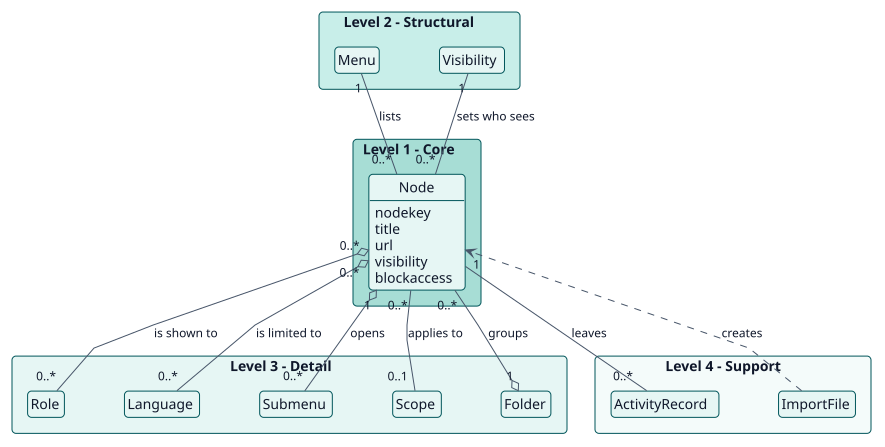
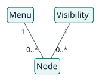
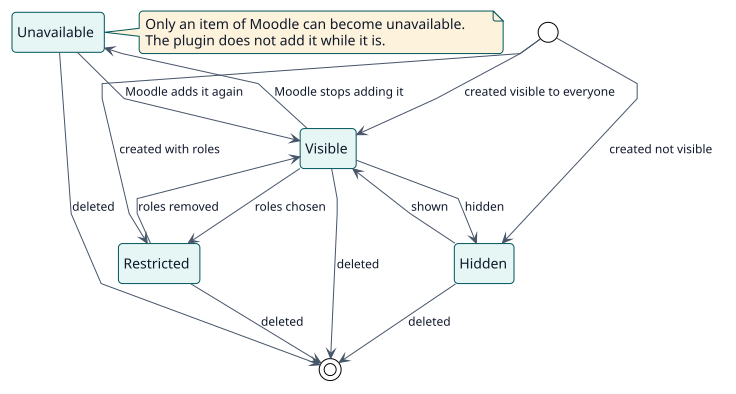

# Modelo de dominio

## Propósito

Los menús de Moodle son iguales para todos y solo se pueden configurar en parte. Extended navigation permite que un administrador dé forma a los dos menús que ve todo usuario y decida, elemento por elemento, quién lo ve y quién puede abrir su página. Este modelo nombra los conceptos que hay detrás.

## Jerarquía de entidades

La posición vertical de una entidad expresa su importancia para el objetivo del proyecto. No es herencia ni composición UML.

| Nivel | Significado | Entidades | Por qué están aquí |
| --- | --- | --- | --- |
| 1 | Núcleo: el proyecto no puede existir sin ellas | Node | El plugin existe para describir un elemento de un menú y sus reglas. |
| 2 | Estructurales: dependen directamente del núcleo | Menu, Visibility | Un nodo pertenece a un menú y tiene una visibilidad. |
| 3 | Detalle: cualifican o especializan el nivel 2 | Role, Language, Submenu | Limitan quién ve un nodo y cómo se anidan los nodos. |
| 4 | Soporte: catálogos, auditoría, configuración | ActivityRecord, ImportFile | Registran lo que cambió y llevan navegaciones entre sitios. |

## Diagramas

## Diccionario de entidades

| Entidad | Nivel | Definición | Atributos clave | Atributos omitidos y motivo |
| --- | --- | --- | --- | --- |
| Node | 1 | Un elemento de una navegación (un menú, una navegación secundaria, la página de preferencias o la administración del sitio), añadido por el plugin o un elemento de Moodle que el plugin cambia. | `nodekey`, `menu`, `title`, `url`, `visibility`, `blockaccess` | El resto están en el [modelo de datos](../design/data-model/data-model.svg). |
| Menu | 2 | Una de las navegaciones: la navegación principal, el menú de usuario, la página de preferencias, la navegación secundaria de la página principal, de un curso y de una categoría, la navegación de cada tipo de actividad y la administración del sitio. | `primary`, `usermenu`, `frontpage`, `course`, `category`, `mod_<módulo>`, `admin` | Es una clase del plugin, no una tabla. |
| Visibility | 2 | Quién ve un nodo: todos, sin límites; los usuarios a los que está restringido, por roles, por condiciones o por ambos; o nadie. | `visibility` | |
| Role | 3 | Un rol que puede ver un nodo restringido. | nombre corto del rol | Es el `role` de Moodle. |
| Condition | 3 | Una restricción de acceso de Moodle sobre un nodo: una fecha, un grupo, un agrupamiento, un campo del perfil o una condición de un plugin. | `availability` | Es el árbol de disponibilidad de Moodle, guardado como JSON en el nodo. |
| Language | 3 | Un idioma al que se limita un nodo. | código de idioma | Es una lista de códigos en el nodo. |
| Submenu | 3 | Los nodos que se muestran bajo un nodo padre, a un nivel de profundidad. | `parentkey` | |
| Folder | 3 | Un nodo sin URL que agrupa otros: un submenú, una sección de las preferencias, una categoría o una pestaña de la administración del sitio. | `url` vacía, `parentkey` de sus hijos | |
| Scope | 3 | El lugar al que se aplica un cambio: todo el sitio, una categoría, un curso, una actividad o un usuario. El más cercano a una página prevalece. | `contextid` | Es el contexto de Moodle. |
| ActivityRecord | 4 | Un evento del registro de Moodle escrito cuando un nodo se crea, cambia o elimina. | evento, usuario, hora | Es el registro de Moodle. |
| ImportFile | 4 | Un archivo YAML que lleva nodos entre sitios. | la lista `nodes` | No se almacena. |

## Reglas de negocio

| ID | Regla | Entidades | Fuente |
| --- | --- | --- | --- |
| RN-001 | Un nodo se muestra a un usuario cuando su visibilidad se lo permite y sus idiomas incluyen el idioma actual del usuario; un padre oculto oculta su submenú. | Node, Role, Language | `access::is_shown` |
| RN-002 | Una clave de nodo es única dentro de su menú, y solo se permiten letras, números, guiones bajos y guiones. | Node | `validator::validate` |
| RN-003 | Se rechaza un cambio que dejaría a todos los usuarios sin una página de destino, y la Administración del sitio nunca puede ocultarse ni anidarse. | Node | `validator::validate` |
| RN-004 | Una URL bloqueada envía al usuario a la primera página de reserva que pueda abrir; si ninguna está permitida, a una página explicativa. | Node | `access_guard::evaluate` |
| RN-005 | Los administradores del sitio, las URL externas y las páginas de administración, de inicio de sesión y de plugins nunca se bloquean. | Node | `access_guard::is_immune` |
| RN-006 | Todo un archivo de importación se comprueba antes de guardar nada. | ImportFile | `importer::import` |
| RN-007 | Reordenar mantiene a un padre con su submenú, y un elemento de submenú solo se mueve entre sus hermanos. | Node, Submenu | `manager::reorder` |
| RN-008 | Un elemento de Moodle con campos vacíos conserva los valores de Moodle. | Node | `text` |
| RN-009 | Un nodo de una navegación secundaria se encuentra cuando una página lo muestra, una sola vez, y desde entonces tiene una fila que se puede cambiar. | Node, Menu | `secondary::record_seen` |
| RN-010 | En la administración del sitio cada categoría y cada página, a cualquier profundidad, se puede renombrar, ocultar y ordenar; un enlace del plugin va en una categoría; sus nodos también se ocultan a los administradores de forma predeterminada. | Node, Menu | `admintree::apply` |
| RN-011 | Un administrador del sitio ve todos los nodos, salvo que el plugin o el nodo se lo oculten también a los administradores. | Node, Role | `access::is_allowed` |
| RN-012 | Para cada nodo gana el ámbito más cercano a la página: el curso, luego las categorías que lo rodean y luego el sitio. | Node, Scope | `repository::get_scoped_nodes` |
| RN-013 | Cuando un ámbito cambia el orden de un nodo, fija el orden de toda su navegación. | Node, Scope | `repository::get_scoped_nodes` |
| RN-014 | Eliminar un nodo del sitio elimina sus excepciones. | Node, Scope | `manager::delete` |
| RN-015 | Un nodo visible para todos se muestra a todos. Un nodo restringido necesita roles, restricciones de acceso (la restricción de acceso de Moodle) o ambos, y se muestra solo cuando los que tiene permiten verlo al usuario; un nodo de un curso se comprueba en ese curso. Los roles y las restricciones que un nodo visible para todos conserva de antes no se usan. | Node, Role, Condition | `access::is_allowed_by_rules`, `availability::allows`, `validator::validate` |
| RN-016 | Las fechas de las restricciones hacen que un nodo esté programado antes de su inicio y finalizado después de su fin; aparece y desaparece por sí solo. | Node, Condition | `availability::period` |
| RN-017 | Las excepciones de un curso viajan en la copia de seguridad del curso; el archivo del sitio contiene los nodos del sitio y las excepciones de sus categorías. | Node, Scope | `backup_local_extendednav_plugin`, `exporter::export_file` |
| RN-018 | Una categoría, un curso o una actividad cambia sus navegaciones en su propia página, por quien gestiona la navegación del sitio o tiene local/extendednav:managecontext en ese contexto; la administración del sitio solo las enumera. | Node, Scope | `context_scope::require_manage`, `node_service::require_scope` |
| RN-019 | Cada tipo de actividad tiene su propia navegación: un cambio hecho en ella se aplica a todas las actividades de ese tipo y a ningún otro tipo. | Menu, Node | `activity::from_key`, `injector::get_origin` |
| RN-020 | Un elemento de la navegación de un tipo de actividad se enumera en cuanto una actividad de ese tipo lo muestra, en una página o al revisar las actividades. | Menu, Node | `secondary::record_seen`, `discovery::kind` |
| RN-021 | Un elemento que Moodle numera se conoce por la ruta de su URL, de modo que tiene la misma clave en todas las páginas. | Node | `secondary::key_of` |
| RN-022 | Los cambios de la navegación única de las actividades de una versión anterior a la 2.0 van a cada tipo que tiene el elemento; un elemento añadido va a todos los tipos; un cambio hecho para una actividad va solo a su tipo. | Menu, Node | `split_activity_navigation::execute` |
| RN-023 | Lo que un usuario organiza en su página se guarda como cambios de su propio contexto, se aplica solo a él y se elimina con el usuario. | Node, Scope | `preferences_injector::apply` |
| RN-024 | La opción para organizar la página nunca se oculta. | Node | `access::is_protected` |
| RN-025 | Una sección sin opciones que mostrar no se muestra; las opciones que no están en ninguna sección forman una sección propia, Miscelánea, que se ordena como cualquier otra. | Node, Folder | `preferences_injector::apply` |
| RN-026 | En su propia página un usuario muestra, oculta, ordena, renombra y mueve opciones; nunca cambia adónde lleva una opción. | Node, Scope | `context_scope::PERSONAL` |
| RN-027 | Solo se eliminan las entradas del plugin más antiguas que el tiempo conservado, nunca las de otro componente. | ActivityRecord | `clean_activity_log::clean` |
| RN-028 | La tarea de depuración solo está activa mientras la depuración está activada y tiene un tiempo; guardar cualquiera de los dos ajustes la activa o la desactiva. | ActivityRecord | `clean_activity_log::sync` |
| RN-029 | El registro se lee por tiempo, un día cada vez y por lotes, a través del índice del tiempo. | ActivityRecord | `clean_activity_log::clean` |
| RN-030 | Mientras la restricción de acceso de Moodle está desactivada, las restricciones de acceso de un nodo dejan pasar a todos, como las de una actividad: un nodo restringido solo por ellas se muestra a todos y su URL no se bloquea, y uno que también tiene roles queda restringido solo por sus roles. Guardar un nodo mientras tanto conserva sus restricciones, que vuelven a aplicarse al activar la restricción de acceso. | Node, Condition | `availability::allows`, `node_form::availability_of` |
| RN-030 | Si los cambios de un curso van en una copia de seguridad y vuelven con una restauración lo deciden dos valores predeterminados de Moodle. | Node, Scope | `settings.php` |
| RN-031 | Restaurar en un curso existente conserva lo que el curso ya establece. | Node, Scope | `restore_local_extendednav_plugin` |
| RN-032 | Un servicio web aplica las mismas reglas y las mismas capacidades que la página que hace lo mismo. | Node | `node_service::require_scope` |
| RN-033 | Una importación omite, con un aviso, lo que nombra una categoría, un curso, una actividad o un usuario que el sitio no tiene. | ImportFile, Scope | `importer::import` |
| RN-034 | Un nodo sin URL agrupa otros: un submenú, una sección, una categoría o una pestaña; solo un grupo se ofrece como padre de otro nodo. | Node, Folder | `validator::validate`, `node_form` |
| RN-035 | Una búsqueda o un filtro de la lista mira en todos los niveles de las carpetas. | Node, Folder | `nodes::get` |
| RN-036 | En una categoría, un curso o una actividad cada tipo de cambio tiene su propia capacidad; un usuario tiene solo las de organizar su propia página. | Scope | `context_scope::can` |

## Ciclos de vida

### Nodo

