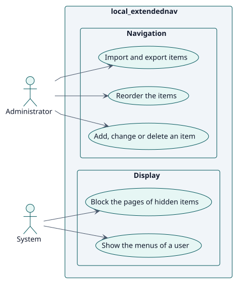
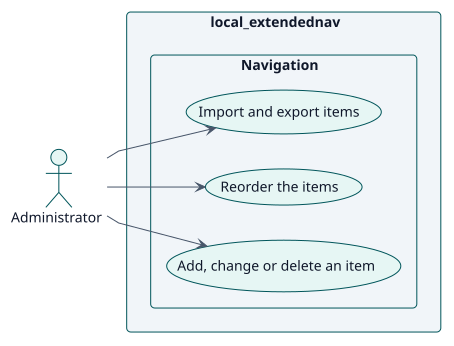
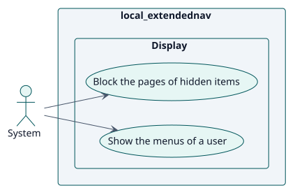

# Requisitos

## Índice

- [Actores](./actors.md)
- [Catálogo de requisitos](./requirements.md)

## Casos de uso

| ID | Caso de uso | Actor | Paquete | Requisito | Análisis | Diseño | Implementación |
| --- | --- | --- | --- | --- | --- | --- | --- |
| UC-001 | [Añadir, cambiar o eliminar un elemento](./use-cases/manageNodes/README.md) | Administrador | Navegación | RF-001 | [ficha](../analysis/use-cases/manageNodes/README.md) | [ficha](../design/use-cases/manageNodes/README.md) | [ficha](../implementation/use-cases/manageNodes/README.md) |
| UC-002 | [Reordenar los elementos](./use-cases/reorderNodes/README.md) | Administrador | Navegación | RF-002 | [ficha](../analysis/use-cases/reorderNodes/README.md) | [ficha](../design/use-cases/reorderNodes/README.md) | [ficha](../implementation/use-cases/reorderNodes/README.md) |
| UC-003 | [Importar y exportar elementos](./use-cases/importNodes/README.md) | Administrador | Navegación | RF-003 | [ficha](../analysis/use-cases/importNodes/README.md) | [ficha](../design/use-cases/importNodes/README.md) | [ficha](../implementation/use-cases/importNodes/README.md) |
| UC-004 | [Mostrar los menús de un usuario](./use-cases/showMenus/README.md) | Sistema | Presentación | RF-004 | [ficha](../analysis/use-cases/showMenus/README.md) | [ficha](../design/use-cases/showMenus/README.md) | [ficha](../implementation/use-cases/showMenus/README.md) |
| UC-005 | [Bloquear las páginas de los elementos ocultos](./use-cases/blockUrl/README.md) | Sistema | Presentación | RF-005 | [ficha](../analysis/use-cases/blockUrl/README.md) | [ficha](../design/use-cases/blockUrl/README.md) | [ficha](../implementation/use-cases/blockUrl/README.md) |

### Diagrama de casos de uso

### Por actor

#### Administrador

#### Sistema

