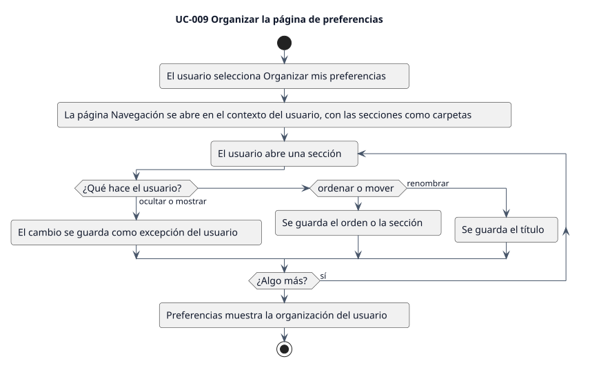

# UC-009 Organizar la página de preferencias

| Vista general | Requisitos | Análisis | Diseño | Implementación | Pruebas |
| --- | --- | --- | --- | --- | --- |
| [Casos de uso](../../../requirements/use-case-overview.svg) | **Requisitos** | [Análisis](../../../analysis/use-cases/arrangePreferences/README.md) | [Diseño](../../../design/use-cases/arrangePreferences/README.md) | [Implementación](../../../implementation/use-cases/arrangePreferences/README.md) | [Pruebas](../../../implementation/use-cases/arrangePreferences/README.md#tests) |

## Información del caso de uso

| Campo | Valor |
| --- | --- |
| Actor | Usuario; un administrador, para la página de otro usuario |
| Paquete | Navegación |
| Objetivo | Ocultar, ordenar, renombrar y mover las secciones y opciones de la página de preferencias, para todo el sitio o para un usuario. |
| Tipo | Primario, real |
| Nivel | Objetivo de usuario |
| Requisito | RF-015 |
| Entidades del dominio | Menu, Node, Scope |

## Contexto

La página de preferencias de Moodle muestra secciones (Cuenta de usuario, Insignias, Blogs...) que contienen opciones (Editar perfil, Cambiar contraseña...). Moodle no tiene una lista de ellas: dependen del usuario y de los plugins instalados. El plugin registra las secciones y opciones que ve y las enumera como carpetas, igual que la administración del sitio. El sitio las organiza para todos desde la página de gestión; cada usuario organiza la suya en la misma lista, abierta en su propio contexto, y un administrador organiza la página de cualquier usuario desde las preferencias de ese usuario.

## Precondiciones

- El plugin y la navegación de las preferencias están activados.
- La persona tiene local/extendednav:personalise (todos los usuarios la tienen de forma predeterminada) o gestiona la navegación del sitio.

## Postcondiciones

- Éxito: La página de preferencias de ese usuario muestra las secciones y opciones como se organizaron; lo que no se cambia sigue lo establecido por el sitio.
- Fallo: La página queda como estaba.

## Flujo principal

| Paso | Actor | Sistema |
| --- | --- | --- |
| 1 | El usuario abre Preferencias y selecciona **Organizar mis preferencias**, en la sección Navegación ampliada. |  |
| 2 |  | Abre la página Navegación en el contexto del usuario, que enumera las secciones como carpetas. |
| 3 | El usuario selecciona el nombre de una sección. | Enumera las opciones de la sección. |
| 4 | El usuario oculta una opción con su botón de ojo, o la vuelve a mostrar. | Guarda el cambio como excepción del contexto del usuario y dibuja la lista de nuevo. |
| 5 | El usuario arrastra una fila para cambiar su lugar, o edita una opción para elegir otra sección o para renombrarla. | Guarda el orden, la sección o el nombre. |
| 6 | El usuario abre Preferencias de nuevo. | Dibuja la página con la organización del usuario. |

## Flujos alternativos

| ID | Empieza en el paso | Condición | Comportamiento | Termina |
| --- | --- | --- | --- | --- |
| A1 | 1 | Un administrador abre las preferencias de otro usuario. | La sección Navegación ampliada ofrece **Organizar las preferencias de** ese usuario y el mismo flujo cambia la página de ese usuario. | Paso 6 |
| A2 | 4 | La persona no puede hacer ese tipo de cambio. | El botón no se muestra y el servicio rechaza el cambio. | Paso 4 |
| A3 | 4 | La opción es la de organizar la página. | No se puede ocultar. | Paso 4 |
| A4 | 5 | El usuario elimina un cambio. | La opción vuelve a seguir lo establecido por el sitio. | Paso 6 |
| A5 | 1 | La persona no tiene local/extendednav:personalise. | La sección Navegación ampliada no se ofrece y la página sigue lo establecido por el sitio. | Paso 6 |

## Reglas de negocio

| ID | Regla |
| --- | --- |
| RN-023 | Lo que un usuario organiza en su página se guarda como cambios de su propio contexto, se aplica solo a él y se elimina con el usuario. |
| RN-024 | La opción para organizar la página nunca se oculta. |
| RN-025 | Una sección sin opciones que mostrar no se muestra; las opciones que no están en ninguna sección forman una sección propia, Miscelánea, que se ordena como cualquier otra. |
| RN-026 | En su propia página un usuario muestra, oculta, ordena, renombra y mueve opciones; nunca cambia adónde lleva una opción. |

## Especificación

Fuente de verdad del comportamiento: [specification.puml](./specification.puml)

## Wireframes

