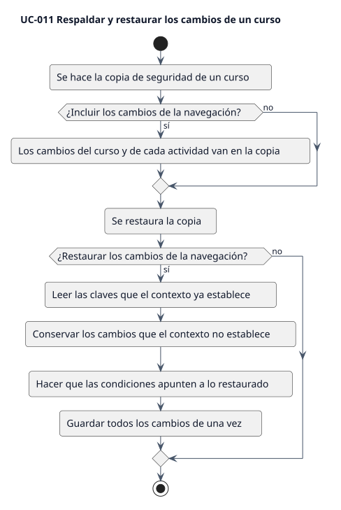

# UC-011 Respaldar y restaurar los cambios de un curso

| Vista general | Requisitos | Análisis | Diseño | Implementación | Pruebas |
| --- | --- | --- | --- | --- | --- |
| [Casos de uso](../../../requirements/use-case-overview.svg) | **Requisitos** | [Análisis](../../../analysis/use-cases/backUpChanges/README.md) | [Diseño](../../../design/use-cases/backUpChanges/README.md) | [Implementación](../../../implementation/use-cases/backUpChanges/README.md) | [Pruebas](../../../implementation/use-cases/backUpChanges/README.md#tests) |

## Información del caso de uso

| Campo | Valor |
| --- | --- |
| Actor | Sistema (la copia de seguridad y la restauración de Moodle) |
| Paquete | Mantenimiento |
| Objetivo | Llevar los cambios que un curso y sus actividades hacen en sus navegaciones en las copias de seguridad de Moodle, según decida el sitio. |
| Tipo | Secundario, esencial |
| Nivel | Subfunción |
| Requisito | RF-017 |
| Entidades del dominio | Node, Scope |

## Contexto

Un curso y cada una de sus actividades pueden cambiar sus navegaciones. Esos cambios pertenecen al curso, así que viajan en su copia de seguridad y vuelven con su restauración, no en el archivo del sitio. El sitio decide, entre los valores predeterminados de Moodle para copias y para restauraciones, si se incluyen.

## Precondiciones

- El curso o la actividad tiene cambios propios, o la copia de seguridad los contiene.

## Postcondiciones

- Éxito: La copia de seguridad contiene los cambios del curso y de sus actividades; la restauración los crea para el curso restaurado, con sus condiciones apuntando a lo restaurado.
- Fallo: Un cambio que el contexto restaurado ya establece se deja como está.

## Flujo principal

| Paso | Actor | Sistema |
| --- | --- | --- |
| 1 | Un administrador o un docente hace una copia de seguridad de un curso. | Añade a la copia los cambios del curso y de cada actividad, cuando **Incluir los cambios de la navegación** está activado en los valores predeterminados de las copias. |
| 2 | Alguien restaura la copia, en un curso nuevo o en uno existente. | Lee los cambios, salvo que **Restaurar los cambios de la navegación** esté desactivado en los valores predeterminados de las restauraciones. |
| 3 |  | Lee una vez los cambios que el contexto restaurado ya establece. |
| 4 |  | Conserva, para cada navegación y clave, el cambio de la copia solo cuando el contexto no lo establece. |
| 5 |  | Cuando el curso y sus actividades están restaurados, hace que las condiciones sobre calificaciones, actividades, grupos y agrupamientos apunten a lo restaurado y desplaza las fechas como se desplaza el curso. |
| 6 |  | Guarda todos los cambios de una vez. |

## Flujos alternativos

| ID | Empieza en el paso | Condición | Comportamiento | Termina |
| --- | --- | --- | --- | --- |
| A1 | 1 | El valor predeterminado de las copias está desactivado. | La copia no contiene ningún cambio. | Paso 2 |
| A2 | 2 | El valor predeterminado de las restauraciones está desactivado. | Los cambios de la copia se dejan fuera. | Paso 6 |
| A3 | 2 | La copia es de una versión anterior a que cada tipo de actividad tuviera su propia navegación. | Los cambios de la navegación única de las actividades pasan al tipo de la actividad restaurada o, en un curso, a cada tipo que tiene el elemento. | Paso 6 |

## Reglas de negocio

| ID | Regla |
| --- | --- |
| RN-017 | Las excepciones de un curso viajan en la copia de seguridad del curso; el archivo del sitio contiene los nodos del sitio y las excepciones de sus categorías. |
| RN-030 | Si los cambios van en una copia de seguridad y vuelven con una restauración lo deciden dos valores predeterminados de Moodle, uno para copias y otro para restauraciones. |
| RN-031 | Restaurar en un curso existente conserva lo que el curso ya establece. |

## Especificación

Fuente de verdad del comportamiento: [specification.puml](./specification.puml)

## Wireframes

