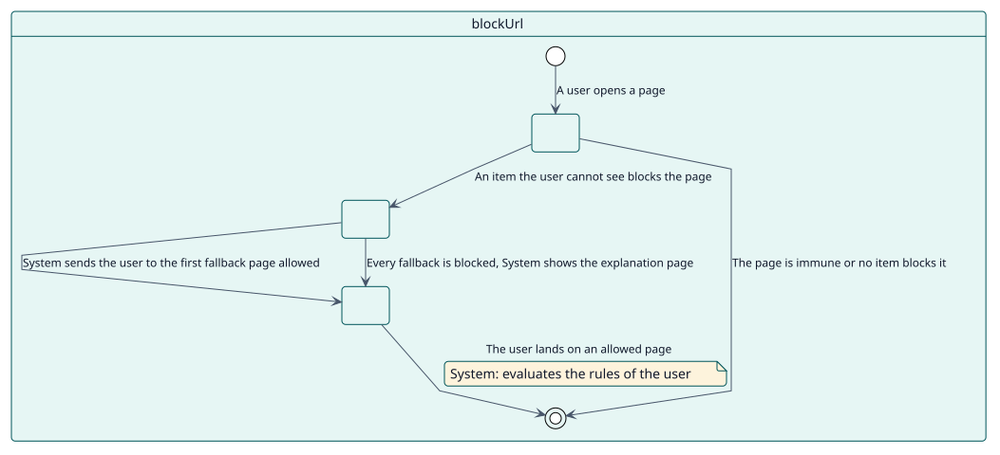
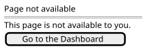

# UC-005 Bloquear las páginas de los elementos ocultos

| Resumen | Requisitos | Análisis | Diseño | Implementación | Pruebas |
| --- | --- | --- | --- | --- | --- |
| [Casos de uso](../../use-case-overview.svg) | **Requisitos** | [Análisis](../../../analysis/use-cases/blockUrl/README.md) | [Diseño](../../../design/use-cases/blockUrl/README.md) | [Implementación](../../../implementation/use-cases/blockUrl/README.md) | [Pruebas](../../../implementation/use-cases/blockUrl/README.md#pruebas) |

## Información del caso de uso

| Campo | Valor |
| --- | --- |
| Actor | Sistema |
| Paquete | Display |
| Objetivo | Impedir que los usuarios abran las páginas de los elementos que no pueden ver. |
| Tipo | Primario, esencial |
| Nivel | Objetivo de usuario |
| Requisito | RF-005 |
| Entidades del dominio | Node, Visibility, Role |

## Contexto

Ocultar un elemento de un menú no impide que un usuario escriba su dirección. Con el bloqueo activado, el plugin lo impide en cada página y envía al usuario adonde puede estar.

## Precondiciones

- El plugin está activado.
- Al menos un nodo tiene **Bloquear el acceso a la URL**.

## Postcondiciones

- Éxito: un usuario que abre una página bloqueada es enviado a la primera página de reserva que pueda abrir.
- Fallo: una página que nada bloquea se muestra como de costumbre.

## Flujo principal

| Paso | Actor | Sistema |
| --- | --- | --- |
| 1 |  | Recibe el gancho que se ejecuta antes de las cabeceras de cada página. |
| 2 |  | Toma la ruta del sitio de la página y comprueba que no es inmune. |
| 3 |  | Lee los nodos y calcula cuáles bloquean la página para este usuario. |
| 4 |  | Envía al usuario a la primera de Área personal, página principal del sitio, Mis cursos y página de inicio predeterminada que esté permitida. |

## Flujos alternativos

| ID | Empieza en el paso | Condición | Comportamiento | Termina |
| --- | --- | --- | --- | --- |
| A1 | 2 | La página es externa, de administración, de inicio de sesión o de plugins, o el usuario es administrador del sitio. | La deja pasar. | Fin |
| A2 | 3 | Un elemento que el usuario puede ver abre la misma URL. | La deja pasar. | Fin |
| A3 | 4 | Todas las páginas de reserva están bloqueadas. | Muestra una página que lo explica. | Fin |

## Reglas de negocio

| ID | Regla |
| --- | --- |
| RN-004 | Una URL bloqueada envía al usuario a la primera página de reserva que pueda abrir. |
| RN-005 | Los administradores, las URL externas y las páginas de administración, de inicio de sesión y de plugins nunca se bloquean. |

## Especificación

Fuente de verdad del comportamiento: [specification.puml](./specification.puml)

## Prototipos

