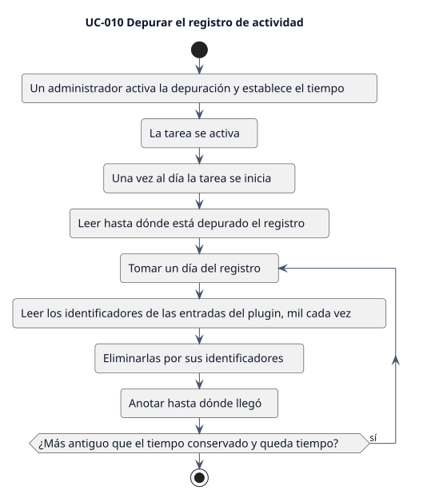
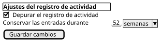

# UC-010 Depurar el registro de actividad

| Vista general | Requisitos | Análisis | Diseño | Implementación | Pruebas |
| --- | --- | --- | --- | --- | --- |
| [Casos de uso](../../../requirements/use-case-overview.svg) | **Requisitos** | [Análisis](../../../analysis/use-cases/cleanActivityLog/README.md) | [Diseño](../../../design/use-cases/cleanActivityLog/README.md) | [Implementación](../../../implementation/use-cases/cleanActivityLog/README.md) | [Pruebas](../../../implementation/use-cases/cleanActivityLog/README.md#tests) |

## Información del caso de uso

| Campo | Valor |
| --- | --- |
| Actor | Sistema (la tarea programada); un administrador la activa |
| Paquete | Mantenimiento |
| Objetivo | Eliminar las entradas del registro de actividad de la navegación que son más antiguas que el tiempo que el sitio las conserva. |
| Tipo | Secundario, esencial |
| Nivel | Subfunción |
| Requisito | RF-016 |
| Entidades del dominio | ActivityRecord |

## Contexto

Los cambios en la navegación se escriben en el registro estándar de Moodle. En un sitio con muchos cambios el registro crece sin límite. El sitio puede conservar las entradas durante un tiempo y una tarea programada elimina las más antiguas. La depuración está desactivada de forma predeterminada y la tarea solo está activa mientras lo está la depuración.

## Precondiciones

- El registro estándar de Moodle está activado.
- Un administrador activó la depuración y estableció durante cuánto tiempo se conservan las entradas.

## Postcondiciones

- Éxito: Las entradas del plugin más antiguas que el tiempo conservado se eliminan; las demás, y todas las entradas de otro componente, quedan como estaban.
- Fallo: No se elimina nada; la siguiente ejecución continúa donde esta se detuvo.

## Flujo principal

| Paso | Actor | Sistema |
| --- | --- | --- |
| 1 | Un administrador activa **Depurar el registro de actividad** y establece **Conservar las entradas durante**, en Informes > Navegación ampliada > Ajustes del registro de actividad. | Guarda los ajustes y activa la tarea programada. |
| 2 |  | Ejecuta la tarea una vez al día, a una hora aleatoria. |
| 3 |  | Lee el momento hasta el que el registro está depurado; la primera vez, el de la entrada más antigua. |
| 4 |  | Toma un día del registro cada vez y lee, por el índice del tiempo, los identificadores de las entradas del plugin, mil cada vez. |
| 5 |  | Elimina esas entradas por sus identificadores y continúa con el siguiente lote y el siguiente día, hasta el tiempo conservado. |
| 6 |  | Anota hasta dónde llegó y se detiene al alcanzar el tiempo conservado o al agotarse su tiempo. |

## Flujos alternativos

| ID | Empieza en el paso | Condición | Comportamiento | Termina |
| --- | --- | --- | --- | --- |
| A1 | 1 | Un administrador desactiva la depuración o no establece ningún tiempo. | La tarea se desactiva y no elimina nada. | Paso 1 |
| A2 | 6 | Se agota el tiempo de la ejecución. | El resto espera a la siguiente ejecución, que continúa desde el momento anotado. | Paso 6 |
| A3 | 4 | El registro no tiene entradas. | No se lee ni se elimina nada. | Paso 6 |

## Reglas de negocio

| ID | Regla |
| --- | --- |
| RN-027 | Solo se eliminan las entradas del plugin más antiguas que el tiempo conservado, nunca las entradas de otro componente. |
| RN-028 | La tarea solo está activa mientras la depuración está activada y tiene un tiempo; guardar cualquiera de los dos ajustes la activa o la desactiva. |
| RN-029 | El registro se lee por tiempo, un día cada vez y por lotes, por el índice del tiempo, nunca la tabla entera de una vez. |

## Especificación

Fuente de verdad del comportamiento: [specification.puml](./specification.puml)

## Wireframes

