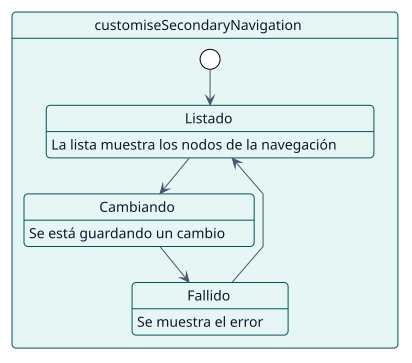
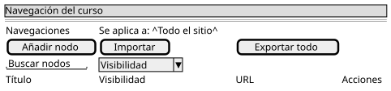

# UC-006 Personalizar una navegación secundaria

| Resumen | Requisitos | Análisis | Diseño | Implementación | Pruebas |
| --- | --- | --- | --- | --- | --- |
| [Casos de uso](../../use-case-overview.svg) | **Requisitos** | [Análisis](../../../analysis/use-cases/customiseSecondaryNavigation/README.md) | [Diseño](../../../design/use-cases/customiseSecondaryNavigation/README.md) | [Implementación](../../../implementation/use-cases/customiseSecondaryNavigation/README.md) | [Pruebas](../../../implementation/use-cases/customiseSecondaryNavigation/README.md#tests) |

## Información del caso de uso

| Campo | Valor |
| --- | --- |
| Actor | Administrator |
| Paquete | Navigation |
| Objetivo | Ordenar, renombrar, ocultar y ampliar la navegación de un curso, una actividad, una categoría o la administración del sitio. |
| Tipo | Primario, esencial |
| Nivel | Objetivo de usuario |
| Requisito | RF-007 |
| Entidades de dominio | Node, Menu, Visibility, Role, Language |

## Contexto

Las navegaciones que Moodle dibuja bajo la cabecera de una página dependen de la página, de quién mira y de los plugins. Un administrador las ordena, renombra u oculta sus nodos, decide cuáles van en el menú Más y añade nodos propios, para todo el sitio.

## Precondiciones

- El administrador tiene `local/extendednav:manage`, o es administrador del sitio.
- El plugin está activado.

## Postcondiciones

- Éxito: el cambio se guarda y la navegación de la página siguiente lo muestra.
- Fallo: el nodo conserva sus valores y la página muestra el error.

## Flujo principal

| Paso | Actor | Sistema |
| --- | --- | --- |
| 1 | Elige una navegación en la columna de la página de gestión. | Lista los nodos que las páginas han mostrado en esa navegación. |
| 2 | Oculta, muestra o mueve un nodo, o selecciona varios y actúa sobre ellos. | Guarda el cambio con una función de servicio web y dibuja la lista de nuevo sin recargar la página. |
| 3 | Edita un nodo: título, enlace, roles, idiomas, dónde va, oculto a los administradores. | Valida el nodo con las reglas del plugin y lo guarda. |
| 4 | Añade un nodo propio. | Lo añade a la navegación después de los nodos de Moodle. |

## Flujos alternativos

| ID | Empieza en el paso | Condición | Comportamiento | Termina |
| --- | --- | --- | --- | --- |
| A1 | 1 | La navegación aún no tiene nodos. | La lista explica que los nodos de Moodle aparecen cuando una página los muestra, y ofrece añadir un nodo. | Paso 1 |
| A2 | 2 | La navegación es la administración del sitio. | La lista muestra un nivel del árbol; el primer nivel agrupa bajo General los elementos de la pestaña General de Moodle. | Paso 2 |
| A3 | 2 | El servidor rechaza el cambio. | Muestra el error y deja la lista como estaba. | Paso 1 |
| A4 | 1 | La navegación es la navegación principal, el menú de usuario o la página de preferencias. | La lista muestra un nivel de las carpetas; una carpeta se marca con una pequeña carpeta tras su nombre y se abre con su nombre. | Paso 1 |
| A5 | 1 | La entrada elegida es Actividades. | La lista muestra los tipos de actividad, con su uso y lo que el sitio cambia; un tipo abre su navegación. | Paso 1 |

## Reglas de negocio

| ID | Regla |
| --- | --- |
| RN-009 | Un nodo de una navegación secundaria se encuentra cuando una página lo muestra, una sola vez, y desde entonces tiene una fila que se puede cambiar. |
| RN-010 | En la administración del sitio cada categoría y cada página, a cualquier profundidad, se puede renombrar, ocultar y ordenar; un enlace del plugin va en una categoría; sus nodos también se ocultan a los administradores de forma predeterminada. |
| RN-011 | Un administrador del sitio ve todos los nodos, salvo que el plugin o el nodo se lo oculten también a los administradores. |
| RN-034 | Un nodo sin URL agrupa otros: un submenú, una sección, una categoría o una pestaña; solo un grupo se ofrece como padre de otro nodo. |
| RN-035 | Una búsqueda o un filtro de la lista mira en todos los niveles de las carpetas. |

## Especificación

Fuente de verdad del comportamiento: [specification.puml](./specification.puml)

## Bocetos de pantalla

