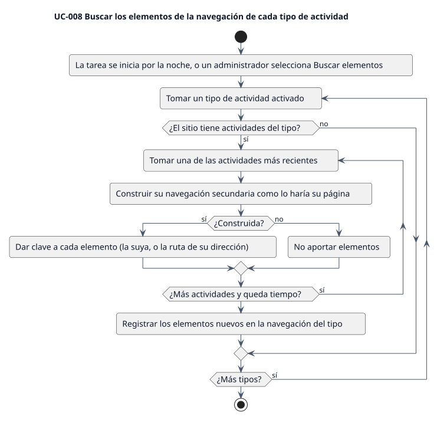
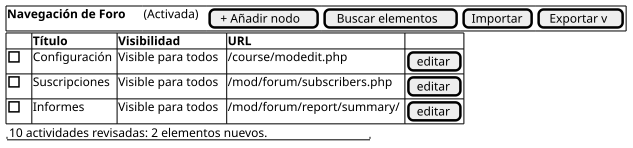

# UC-008 Buscar los elementos de la navegación de cada tipo de actividad

| Vista general | Requisitos | Análisis | Diseño | Implementación | Pruebas |
| --- | --- | --- | --- | --- | --- |
| [Casos de uso](../../../requirements/use-case-overview.svg) | **Requisitos** | [Análisis](../../../analysis/use-cases/discoverActivityItems/README.md) | [Diseño](../../../design/use-cases/discoverActivityItems/README.md) | [Implementación](../../../implementation/use-cases/discoverActivityItems/README.md) | [Pruebas](../../../implementation/use-cases/discoverActivityItems/README.md#tests) |

## Información del caso de uso

| Campo | Valor |
| --- | --- |
| Actor | Sistema (la tarea programada); un administrador desde la lista de un tipo de actividad |
| Paquete | Navegación |
| Objetivo | Enumerar los elementos que Moodle y sus plugins añaden a la navegación de cada tipo de actividad, para poder cambiarlos antes de que alguien abra una de esas actividades. |
| Tipo | Secundario, esencial |
| Nivel | Subfunción |
| Requisito | RF-012 |
| Entidades del dominio | Menu, Node |

## Contexto

Moodle no tiene una lista de los elementos de la navegación de una actividad: dependen del tipo de actividad, de los plugins instalados y, en algunos plugins, de cómo está configurada cada actividad. Un informe que un plugin añade solo a las tareas que lo usan aparece únicamente en esas tareas. Las páginas registran lo que muestran, pero un elemento que nadie ha abierto todavía no se puede cambiar. Este caso de uso construye la navegación de las actividades del sitio, como lo harían sus páginas, y enumera lo que encuentra.

## Precondiciones

- El plugin está activado.
- El tipo de actividad está activado en el sitio.

## Postcondiciones

- Éxito: cada elemento encontrado en una actividad del tipo está en la lista de su navegación, con su texto y su URL, y tiene una fila que se puede cambiar.
- Fallo: una actividad cuya navegación no se puede construir no aporta elementos; las demás se siguen revisando.

## Flujo principal

| Paso | Actor | Sistema |
| --- | --- | --- |
| 1 | La tarea programada se inicia una vez al día, como administrador. | |
| 2 | | Toma cada tipo de actividad activado. |
| 3 | | Toma las actividades más recientes del tipo, hasta 50. |
| 4 | | Construye la navegación secundaria de cada actividad, con la página de la actividad como página en construcción. |
| 5 | | Da a cada elemento su clave: la que le da Moodle o, para un elemento que Moodle numera, la ruta de su URL. |
| 6 | | Registra los elementos nuevos en la navegación del tipo y da una fila a cada uno. |

## Flujos alternativos

| ID | Empieza en el paso | Condición | Comportamiento | Termina |
| --- | --- | --- | --- | --- |
| A1 | 1 | Un administrador selecciona **Buscar elementos** en la lista de un tipo de actividad. | El mismo flujo se ejecuta solo para ese tipo, con las 30 actividades más recientes y 8 segundos como máximo, y la lista se dibuja de nuevo con el número de actividades revisadas y de elementos encontrados. | Paso 6 |
| A2 | 3 | El tipo no tiene ninguna actividad en el sitio. | No se revisa nada; la página indica que el sitio no tiene ninguna actividad de ese tipo. | Paso 3 |
| A3 | 4 | La navegación de una actividad no se puede construir. | La actividad no aporta elementos y se toma la siguiente. | Paso 4 |
| A4 | 4 | Se agota el tiempo de la tarea. | Las actividades restantes esperan a la siguiente ejecución. | Paso 6 |

## Reglas de negocio

| ID | Regla |
| --- | --- |
| RN-019 | Cada tipo de actividad tiene su propia navegación. |
| RN-020 | Un elemento se enumera en cuanto una actividad de su tipo lo muestra. |
| RN-021 | Un elemento que Moodle numera se conoce por la ruta de su URL. |

## Especificación

Fuente de verdad del comportamiento: [specification.puml](./specification.puml)

## Wireframes

