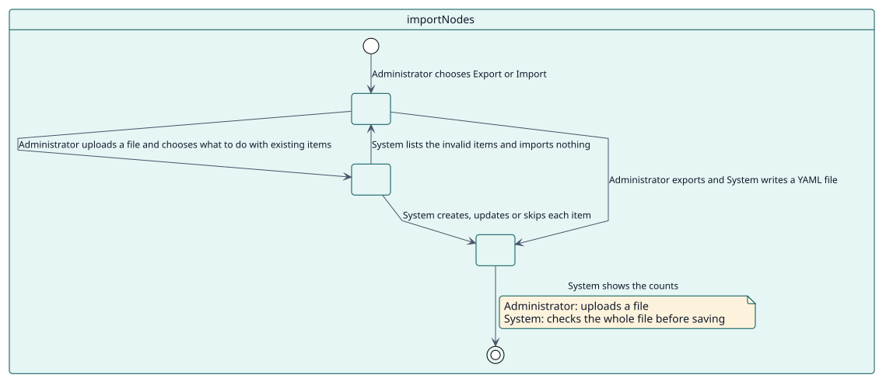
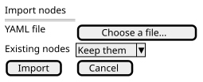

# UC-003 Importar y exportar elementos

| Resumen | Requisitos | Análisis | Diseño | Implementación | Pruebas |
| --- | --- | --- | --- | --- | --- |
| [Casos de uso](../../use-case-overview.svg) | **Requisitos** | [Análisis](../../../analysis/use-cases/importNodes/README.md) | [Diseño](../../../design/use-cases/importNodes/README.md) | [Implementación](../../../implementation/use-cases/importNodes/README.md) | [Pruebas](../../../implementation/use-cases/importNodes/README.md#pruebas) |

## Información del caso de uso

| Campo | Valor |
| --- | --- |
| Actor | Administrador |
| Paquete | Navigation |
| Objetivo | Copiar la navegación de un sitio a otro. |
| Tipo | Primario, esencial |
| Nivel | Objetivo de usuario |
| Requisito | RF-003 |
| Entidades del dominio | ImportFile, Node |

## Contexto

Una navegación cuesta trabajo construirla. Un administrador exporta sus elementos a un archivo YAML y lo importa en otro sitio; todo el archivo se comprueba antes de guardar nada.

## Precondiciones

- El administrador tiene `local/extendednav:manage`.

## Postcondiciones

- Éxito: el archivo se escribe, o los elementos se crean, actualizan u omiten y se muestran los recuentos.
- Fallo: un archivo no válido no importa nada y se listan todos los errores.

## Flujo principal

| Paso | Actor | Sistema |
| --- | --- | --- |
| 1 | Elige **Exportar todo**, o selecciona elementos y **Exportar los seleccionados**. | Escribe un archivo YAML con cada elemento y su posición. |
| 2 | Elige **Importar**, sube un archivo y elige qué hacer con los elementos existentes. | Lee el archivo y valida cada elemento. |
| 3 |  | Crea, actualiza u omite cada elemento, conservando su posición. |
| 4 |  | Muestra los recuentos y las advertencias, como un idioma que no está instalado. |

## Flujos alternativos

| ID | Empieza en el paso | Condición | Comportamiento | Termina |
| --- | --- | --- | --- | --- |
| A1 | 2 | Un elemento no es válido. | Lista cada elemento no válido con el motivo y no importa nada. | Paso 2 |
| A2 | 2 | El archivo no tiene una lista `nodes`. | Rechaza el archivo. | Paso 2 |

## Reglas de negocio

| ID | Regla |
| --- | --- |
| RN-006 | Todo el archivo se comprueba antes de guardar nada. |

## Especificación

Fuente de verdad del comportamiento: [specification.puml](./specification.puml)

## Prototipos

