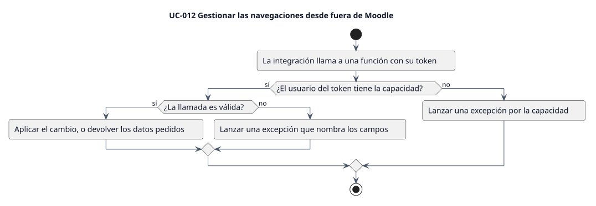

# UC-012 Gestionar las navegaciones desde fuera de Moodle

| Vista general | Requisitos | Análisis | Diseño | Implementación | Pruebas |
| --- | --- | --- | --- | --- | --- |
| [Casos de uso](../../../requirements/use-case-overview.svg) | **Requisitos** | [Análisis](../../../analysis/use-cases/manageByWebService/README.md) | [Diseño](../../../design/use-cases/manageByWebService/README.md) | [Implementación](../../../implementation/use-cases/manageByWebService/README.md) | [Pruebas](../../../implementation/use-cases/manageByWebService/README.md#tests) |

## Información del caso de uso

| Campo | Valor |
| --- | --- |
| Actor | Integración (un sistema fuera de Moodle con un token) |
| Paquete | Navegación |
| Objetivo | Leer, cambiar, exportar e importar las navegaciones mediante los servicios web del plugin. |
| Tipo | Primario, real |
| Nivel | Objetivo de usuario |
| Requisito | RF-018 |
| Entidades del dominio | Menu, Node, Scope |

## Contexto

Todo lo que hace la página de gestión se hace con servicios web, así que un sistema fuera de Moodle también puede hacerlo: enumerar las navegaciones y sus nodos, añadir y cambiar un nodo, mostrar, ocultar, ordenar y eliminar nodos, activar o desactivar una navegación y mover navegaciones enteras a un archivo y desde él. Las funciones están reunidas en el servicio Navegación ampliada, que un administrador activa y al que da un token.

## Precondiciones

- El servicio Navegación ampliada está activado y la integración tiene un token de un usuario que tiene las capacidades que las funciones necesitan.

## Postcondiciones

- Éxito: El cambio se hace, como se haría desde la página de gestión, o se devuelven los datos pedidos.
- Fallo: La función lanza una excepción y no se guarda nada.

## Flujo principal

| Paso | Actor | Sistema |
| --- | --- | --- |
| 1 | La integración llama a `local_extendednav_get_navigations`. | Devuelve cada navegación con su clave, su nombre, si está activada, si es un árbol de carpetas y si la cambian contextos. |
| 2 | La integración llama a `local_extendednav_get_nodes` para una navegación y un contexto. | Comprueba la capacidad y devuelve una página de nodos. |
| 3 | La integración llama a `local_extendednav_save_node` con la clave de un nodo y los campos a establecer. | Comprueba las capacidades y los campos que el contexto permite, valida el nodo con las reglas del formulario y lo guarda. |
| 4 | La integración llama a `local_extendednav_set_visibility`, `local_extendednav_reorder_nodes` o `local_extendednav_delete_nodes`. | Aplica el cambio con la capacidad de ese tipo de cambio. |
| 5 | La integración llama a `local_extendednav_export_navigations` con las navegaciones y los contextos deseados. | Devuelve el archivo en YAML. |
| 6 | La integración llama a `local_extendednav_import_navigations` con un archivo. | Comprueba el archivo entero y lo guarda, omitiendo con un aviso los contextos que el sitio no tiene. |

## Flujos alternativos

| ID | Empieza en el paso | Condición | Comportamiento | Termina |
| --- | --- | --- | --- | --- |
| A1 | 2 | El usuario del token no tiene la capacidad. | La función lanza una excepción por la capacidad. | Paso 2 |
| A2 | 3 | Un campo no es válido, o el contexto no lo permite. | La función lanza una excepción que nombra los campos y no guarda nada. | Paso 3 |
| A3 | 6 | Un nodo del archivo nombra una categoría, un curso, una actividad o un usuario que no existe. | Se omite y el resultado incluye un aviso; el resto se importa. | Paso 6 |
| A4 | 6 | Un nodo del archivo no es válido. | No se guarda nada y el resultado enumera los errores. | Paso 6 |

## Reglas de negocio

| ID | Regla |
| --- | --- |
| RN-032 | Un servicio web aplica las mismas reglas y las mismas capacidades que la página que hace lo mismo. |
| RN-033 | Una importación omite, con un aviso, lo que nombra una categoría, un curso, una actividad o un usuario que el sitio no tiene. |

## Especificación

Fuente de verdad del comportamiento: [specification.puml](./specification.puml)

## Wireframes

