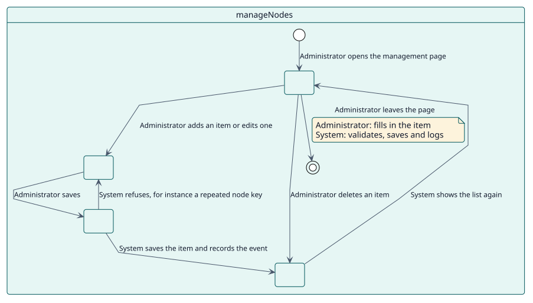
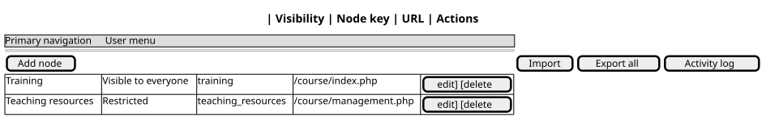

# UC-001 Añadir, cambiar o eliminar un elemento

| Resumen | Requisitos | Análisis | Diseño | Implementación | Pruebas |
| --- | --- | --- | --- | --- | --- |
| [Casos de uso](../../use-case-overview.svg) | **Requisitos** | [Análisis](../../../analysis/use-cases/manageNodes/README.md) | [Diseño](../../../design/use-cases/manageNodes/README.md) | [Implementación](../../../implementation/use-cases/manageNodes/README.md) | [Pruebas](../../../implementation/use-cases/manageNodes/README.md#pruebas) |

## Información del caso de uso

| Campo | Valor |
| --- | --- |
| Actor | Administrador |
| Paquete | Navigation |
| Objetivo | Dar forma a la navegación principal y al menú de usuario elemento por elemento. |
| Tipo | Primario, esencial |
| Nivel | Objetivo de usuario |
| Requisito | RF-001 |
| Entidades del dominio | Node, Menu, Visibility, Role, Language, ActivityRecord |

## Contexto

Un administrador añade elementos a un menú, cambia los elementos de Moodle o quita elementos, y decide quién ve cada uno y si su página se bloquea.

## Precondiciones

- El administrador tiene `local/extendednav:manage`, o es administrador del sitio.

## Postcondiciones

- Éxito: el elemento queda guardado, el menú lo muestra al instante y el cambio queda registrado.
- Fallo: no se guarda nada y el formulario muestra qué corregir.

## Flujo principal

| Paso | Actor | Sistema |
| --- | --- | --- |
| 1 | Abre la página de gestión y elige **Añadir nodo**, o el icono de edición de un elemento. | Muestra el formulario, con los valores de Moodle como texto de ejemplo en sus elementos. |
| 2 | Rellena la clave, el título, la URL, el icono, la visibilidad, los roles, los idiomas y el padre, y guarda. | Valida el elemento frente a los demás de su menú. |
| 3 |  | Lo guarda en `local_extendednav` y lanza `node_created` o `node_updated`. |
| 4 | Elimina un elemento. | Lo elimina y lanza `node_deleted`. |

## Flujos alternativos

| ID | Empieza en el paso | Condición | Comportamiento | Termina |
| --- | --- | --- | --- | --- |
| A1 | 2 | La clave está repetida o no es válida, o falta la URL o el título. | Muestra el error bajo el campo; no se guarda nada. | Paso 1 |
| A2 | 2 | El cambio dejaría a todos los usuarios sin una página de destino. | Lo rechaza. | Paso 1 |
| A3 | 2 | El elemento es la Administración del sitio y se oculta o se anida. | Lo rechaza. | Paso 1 |

## Reglas de negocio

| ID | Regla |
| --- | --- |
| RN-002 | Una clave de nodo es única dentro de su menú. |
| RN-003 | Se rechaza un cambio que dejaría a todos los usuarios sin una página de destino. |
| RN-008 | Un elemento de Moodle con campos vacíos conserva los valores de Moodle. |

## Especificación

Fuente de verdad del comportamiento: [specification.puml](./specification.puml)

## Prototipos

