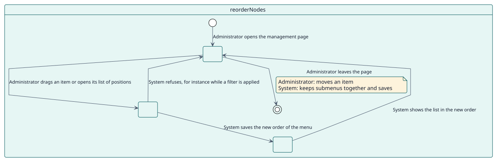
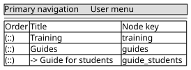

# UC-002 Reordenar los elementos

| Resumen | Requisitos | Análisis | Diseño | Implementación | Pruebas |
| --- | --- | --- | --- | --- | --- |
| [Casos de uso](../../use-case-overview.svg) | **Requisitos** | [Análisis](../../../analysis/use-cases/reorderNodes/README.md) | [Diseño](../../../design/use-cases/reorderNodes/README.md) | [Implementación](../../../implementation/use-cases/reorderNodes/README.md) | [Pruebas](../../../implementation/use-cases/reorderNodes/README.md#pruebas) |

## Información del caso de uso

| Campo | Valor |
| --- | --- |
| Actor | Administrador |
| Paquete | Navigation |
| Objetivo | Cambiar la posición de los elementos de un menú. |
| Tipo | Primario, esencial |
| Nivel | Objetivo de usuario |
| Requisito | RF-002 |
| Entidades del dominio | Node, Menu, Submenu |

## Contexto

El orden de la lista es el orden del menú. Un administrador arrastra un elemento, o elige una posición con el teclado, y los submenús se mantienen juntos.

## Precondiciones

- El administrador tiene `local/extendednav:manage`.
- No hay ningún filtro aplicado.

## Postcondiciones

- Éxito: el nuevo orden queda guardado y el menú lo muestra.
- Fallo: el orden no cambia.

## Flujo principal

| Paso | Actor | Sistema |
| --- | --- | --- |
| 1 | Arrastra un elemento por su asa, o abre su lista de posiciones. | Calcula el nuevo orden del menú. |
| 2 | Lo suelta. | Guarda el orden mediante la función de servicio web. |
| 3 |  | Mantiene a un padre con sus elementos de submenú. |

## Flujos alternativos

| ID | Empieza en el paso | Condición | Comportamiento | Termina |
| --- | --- | --- | --- | --- |
| A1 | 1 | Hay un filtro aplicado. | El orden está desactivado. | Paso 1 |
| A2 | 2 | El servidor rechaza el orden. | Muestra el error y deja la lista como estaba. | Paso 1 |

## Reglas de negocio

| ID | Regla |
| --- | --- |
| RN-007 | Un padre se mueve con su submenú; un elemento de submenú solo se mueve entre sus hermanos. |

## Especificación

Fuente de verdad del comportamiento: [specification.puml](./specification.puml)

## Prototipos

