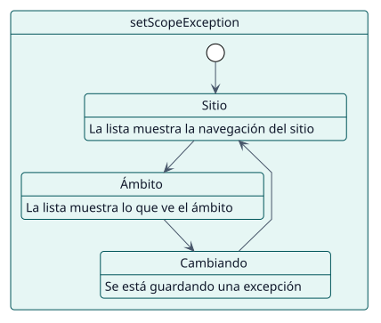
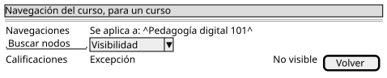

# UC-007 Cambiar una navegación para una categoría, un curso o una actividad

| Resumen | Requisitos | Análisis | Diseño | Implementación | Pruebas |
| --- | --- | --- | --- | --- | --- |
| [Casos de uso](../../use-case-overview.svg) | **Requisitos** | [Análisis](../../../analysis/use-cases/setScopeException/README.md) | [Diseño](../../../design/use-cases/setScopeException/README.md) | [Implementación](../../../implementation/use-cases/setScopeException/README.md) | [Pruebas](../../../implementation/use-cases/setScopeException/README.md#tests) |

## Información del caso de uso

| Campo | Valor |
| --- | --- |
| Actor | Administrator |
| Paquete | Navigation |
| Objetivo | Dar a una categoría o a un curso su propia versión de una navegación, mientras el resto del sitio conserva la navegación del sitio. |
| Tipo | Primario, esencial |
| Nivel | Objetivo de usuario |
| Requisito | RF-008 |
| Entidades de dominio | Node, Scope, Menu, Visibility |

## Contexto

A veces una categoría, un curso o una actividad necesitan otro orden, otros nombres u otros nodos que el sitio. Un administrador fija una excepción para ella; todo lo que hay dentro de una categoría la sigue, y un curso puede cambiar lo que fija su categoría.

## Precondiciones

- El administrador tiene `local/extendednav:manage`, o es administrador del sitio.
- La navegación es la de un curso, una actividad o una categoría.

## Postcondiciones

- Éxito: la categoría o el curso tiene filas propias, y sus páginas las muestran.
- Fallo: el ámbito sigue al sitio.

## Flujo principal

| Paso | Actor | Sistema |
| --- | --- | --- |
| 1 | Abre **Se aplica a** y busca una categoría, un curso o una actividad. | Lista los ámbitos que tienen cambios y los que encuentra la búsqueda. |
| 2 | Elige el ámbito. | Lista lo que muestran sus páginas: los nodos del sitio y los que hereda, marcados como excepción o heredado. |
| 3 | Oculta, mueve o edita un nodo. | Si no la tiene, hace una fila del ámbito como copia del nodo al que sustituye, y la cambia. |
| 4 | Vuelve al sitio para un nodo. | Elimina la fila del ámbito, y el nodo vuelve a ser el del sitio. |

## Flujos alternativos

| ID | Empieza en el paso | Condición | Comportamiento | Termina |
| --- | --- | --- | --- | --- |
| A1 | 2 | La navegación no tiene excepciones (principal, menú de usuario, administración). | La página no ofrece ámbito. | Paso 1 |
| A2 | 1 | La búsqueda no encuentra nada. | El menú indica que ninguna categoría ni curso coincide. | Paso 1 |
| A3 | 1 | El ámbito es un usuario. | Solo puede cambiar la página de preferencias, desde las preferencias de ese usuario; ninguna lista ofrece a todos los usuarios. | Paso 1 |
| A4 | 3 | La persona no tiene la capacidad de ese tipo de cambio. | Los campos de ese cambio no están en el formulario y la acción no se ofrece. | Paso 3 |

## Reglas de negocio

| ID | Regla |
| --- | --- |
| RN-012 | Para cada nodo gana el ámbito más cercano a la página: el curso, luego las categorías que lo rodean y luego el sitio. |
| RN-013 | Cuando un ámbito cambia el orden de un nodo, fija el orden de toda su navegación. |
| RN-014 | Eliminar un nodo del sitio elimina sus excepciones. |
| RN-036 | En una categoría, un curso o una actividad cada tipo de cambio tiene su propia capacidad; un usuario tiene solo las de organizar su propia página. |

## Especificación

Fuente de verdad del comportamiento: [specification.puml](./specification.puml)

## Bocetos de pantalla

