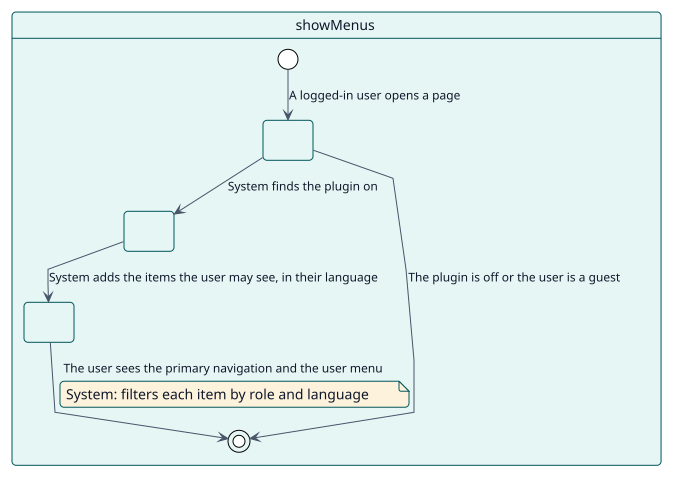
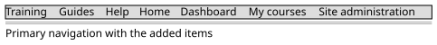

# UC-004 Mostrar los menús de un usuario

| Resumen | Requisitos | Análisis | Diseño | Implementación | Pruebas |
| --- | --- | --- | --- | --- | --- |
| [Casos de uso](../../use-case-overview.svg) | **Requisitos** | [Análisis](../../../analysis/use-cases/showMenus/README.md) | [Diseño](../../../design/use-cases/showMenus/README.md) | [Implementación](../../../implementation/use-cases/showMenus/README.md) | [Pruebas](../../../implementation/use-cases/showMenus/README.md#pruebas) |

## Información del caso de uso

| Campo | Valor |
| --- | --- |
| Actor | Sistema |
| Paquete | Display |
| Objetivo | Mostrar a cada usuario los elementos que sus roles e idioma permiten. |
| Tipo | Primario, esencial |
| Nivel | Objetivo de usuario |
| Requisito | RF-004 |
| Entidades del dominio | Node, Menu, Visibility, Role, Language |

## Contexto

En cada página, Moodle pide a sus ganchos que amplíen la navegación principal y que construyan el menú de usuario. El plugin añade los elementos que el usuario puede ver y deja fuera el resto.

## Precondiciones

- El plugin está activado.
- El usuario ha iniciado sesión y no es el invitado.

## Postcondiciones

- Éxito: la navegación principal y el menú de usuario muestran los elementos del usuario, en orden.
- Fallo: Moodle muestra su navegación sin cambios.

## Flujo principal

| Paso | Actor | Sistema |
| --- | --- | --- |
| 1 |  | Recibe el gancho que amplía la navegación principal. |
| 2 |  | Comprueba que el plugin está activado y que el usuario ha iniciado sesión. |
| 3 |  | Lee los nodos del menú y conserva los que el usuario puede ver, en el idioma del usuario. |
| 4 |  | Los añade a la navegación principal y construye el menú de usuario para el usuario. |

## Flujos alternativos

| ID | Empieza en el paso | Condición | Comportamiento | Termina |
| --- | --- | --- | --- | --- |
| A1 | 2 | El plugin está desactivado, o el usuario es invitado. | No hace nada. | Fin |
| A2 | 3 | Un padre está oculto. | Deja fuera su submenú. | Paso 4 |
| A3 | 4 | La página es una página de ajustes de administración. | Restaura los ajustes reales del menú, para que el formulario los muestre. | Fin |

## Reglas de negocio

| ID | Regla |
| --- | --- |
| RN-001 | Un nodo se muestra cuando su visibilidad y sus idiomas lo permiten al usuario. |
| RN-008 | Un elemento de Moodle con campos vacíos conserva los valores de Moodle. |

## Especificación

Fuente de verdad del comportamiento: [specification.puml](./specification.puml)

## Prototipos

